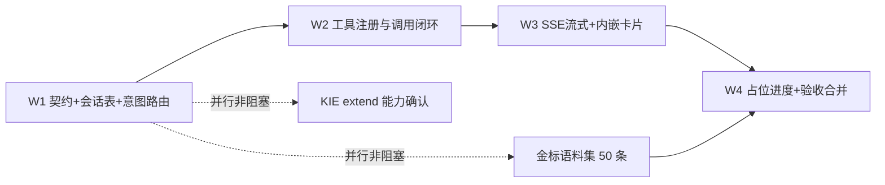

# 对话式 Agent 创作改造 · 架构勘察与开发计划

> 结论先行：**不需要推翻重来，也不需要重写音乐生成链路。** 目标界面（三栏对话 + 指令胶囊 + 歌曲预览）已经作为生产 Vue 页面存在于 `/agent`；后端已具备歌词生成、音乐生成、局部重唱、风格配方、8 态任务状态机、租约恢复与额度幂等。真正缺的是三件东西：**服务端会话状态、工具调用层、SSE 事件通道**，以及一处必须拆除的行为——`/agent` 的 `beginCreation()` 会主动跳转到 `/create`。
>
> 因此本计划的最小改造是：保留 `/agent` 的 DOM/CSS 骨架与 `/create` 表单页不动，把「本地规则模拟 + 跳转」替换为「后端意图路由 → 工具分发 → SSE 事件 → 消息内嵌卡片」，工具实现全部委托现有 Service。不引入 Spring AI、LangChain4j、Redis、WebFlux、消息队列。
>
> 勘察时点：2026-11-11；分支 `main`；生产库最大迁移版本 28（存在 V27/V28 撞号漂移，见风险 R7）。

---

## 一、架构勘察结论

### 1.1 前端（Qingfeng_AI_Music_VUE）

| 维度 | 结论 | 关键文件 |
|---|---|---|
| 技术栈 | Vue 3.5.44 + TypeScript 5.9 + Vite 8 + Pinia 4.1.0 + vue-router 5.4 + Vitest 5；`package.json` 无 axios | `package.json` |
| 状态管理 | **全库仅 1 个 Pinia store**：`usePlayer`（播放器 current/queue/playing/time/segment），不持久化。其余全局态是模块级 `ref` 单例（`account-state.ts`、`credit-balance.ts`）。**无对话状态、无 current_song** | `src/shared/player/store.ts` L5–8 |
| 路由 | 单文件定义。`/agent` → `AgentStudioPage.vue`；`/create` → `DraftStudioPage.vue`；`/works/:id` → `WorkDetailPage.vue` | `src/app/router/index.ts` L9–23 |
| 导航 | 「开始创作 / Agent 创作(New) / 我的音乐 / 充值」 | `src/app/layouts/PremiumWebLayout.vue` L27–28、L91–92 |
| **对话区** | **目标界面已存在**：`AgentStudioPage.vue`（470 行）。左 `.agent-assistant-panel`（灵感卡片/兴趣标签/上传参考音乐/开启创作之旅）、中 `.agent-conversation`（欢迎语 + 6 条指令胶囊）、右 `.agent-preview`（封面/播放器/歌词/喜欢/下载/更多）、底 `.agent-composer`（输入框 + 5 个快捷标签）。样式 `src/app/styles/agent.css` | `src/modules/agent/pages/AgentStudioPage.vue` L34、L355–468 |
| **对话真伪** | **本地规则模拟，非 LLM、非后端**。欢迎语 `greetingLines` L34；`send()` L118–134 调 `analyzeRequest()` 后用 `setTimeout(...,420)` 造一条回复；`messages` 是组件局部 `ref<Message[]>` L36，刷新即丢、无会话 ID | 同上；`src/modules/agent/model/assistant.ts` L193 |
| **跳转行为** | `beginCreation()` L177–187：写 `sessionStorage['qingfeng.agent.brief']` → **`router.push({path:'/create', query:{from:'agent'}})`**。「用它开始创作」按钮 L426 同样调用它 | 同上 L186、L426 |
| 规则解析 | `assistant.ts`：`matchTheme()` 10 个关键词主题、`extractParams()`（BPM/人声/乐器/语言/段落）、`modeOptions` 5 模式、`quickPrompts` 6 胶囊（旅行/电影/治愈/粤语/海岛/生日）、`inspirationBoards`、`interestTags` | `src/modules/agent/model/assistant.ts` L29–140 |
| 右栏数据来源 | **静态样例 3 首**：`usePreviewTracks()` + `previewOrder=[2,0,7]`，歌词 `lyricBoards` 硬编码。未接真实作品 | `AgentStudioPage.vue` L63–72、L456–467 |
| 卡片组件 | `SongResult.vue`（整页 `<section id="song-result">`，仅 WorkDetailPage 用）、`SectionEditor.vue`、`SyncedLyrics.vue`、`AudioPanel.vue`、`CoverEditor.vue`。播放器为 `GlobalPlayer.vue` + `usePlayer` + `audio-cache.ts`（`engine.ts` 是未引用的桩）。**无可嵌入消息流的卡片** | `src/modules/works/components/`、`src/shared/player/` |
| 网络层 | 原生 fetch：`requestJson`（10s AbortController、`X-XSRF-TOKEN`、`validResponse` 契约校验）、`uploadForm`、`ensureCreator()`（POST `public/session`）。**无拦截器** | `src/shared/http/api-client.ts` L16–33、L52 |
| 流式 | **无 SSE**：全库无 `EventSource` / `ReadableStream` / `getReader` / `text/event-stream` / `text_delta`。生成状态靠 **8 秒轮询** `setInterval(...,8000)` + `refreshTasks()`，另有 `visibilitychange` 触发 | `src/modules/works/pages/WorkDetailPage.vue` L119、`WorkLibraryPage.vue` L16 |
| 主创作流程 | `/create` 是**表单/向导式**（`<form @submit.prevent="next">` + `CreationSteps` 5 步），`next()` → `saveWork()` → `generateLyrics()` → `push('/works/{id}...')` | `src/modules/studio/pages/DraftStudioPage.vue` L185–299 |
| 测试 | 62 个 `tests/*.test.ts`、约 371 用例；6 个文件用 `@vue/test-utils` + happy-dom/jsdom 做组件测试，基建完备 | `tests/agent-studio-page.test.ts` 等 |
| 本地持久化 | localStorage：草稿副本 `qingfeng.recovery.v1:*`、偏好、埋点 vid；sessionStorage：`qingfeng.agent.brief`、section-edit、cover-edit 等。无 indexedDB | `src/shared/drafts/recovery.ts`、`src/modules/agent/model/brief.ts` |

> 补充：`ui-prototype/` 是**四步表单静态 HTML 原型**，不是对话界面，也不是目标参考实现；目标参考实现就是 `AgentStudioPage.vue` 本身。

### 1.2 后端（Qingfeng_AI_Music）

| 维度 | 结论 | 关键文件 |
|---|---|---|
| 技术栈 | Spring Boot 4.1.2 / Java 17 / MyBatis（**注解 SQL，无 Mapper XML**）/ MySQL / Flyway V1–V28 | 根 `pom.xml` L4–8 |
| 模块 | `qf-common` / `qf-business` / `qf-infrastructure` / `qf-server` 模块化单体；领域 `studio/identity/work/lyrics/generation/media/sharing/catalog/cover/usage/credits/settings/agent`，各分 `api/application/domain` | `docs/模块架构设计.md` §3–6 |
| Web 层 | 约 20 个 `web/app` Controller + 9 个 `publicapi` Controller，**全部同步 REST（Servlet webmvc）**。示例：`AgentReferenceController` `@Profile({"mysql","test"})` + `@RequestMapping("/api/app/agent")` | `qf-server/.../web/app/AgentReferenceController.java` |
| **SSE / 异步** | **main 目录无** `SseEmitter` / `ResponseBodyEmitter` / `StreamingResponseBody` / `WebFlux` / `Flux` / `@Async` / `CompletableFuture` / 自定义线程池 Bean。仅 `ExecutionConfiguration` 的 `@EnableScheduling` + `Runner.scan()` `@Scheduled(fixedDelay=3000)` 驱动 `GenerationWorker.runOnce()` | `qf-server/.../config/ExecutionConfiguration.java` L16–29 |
| LLM 编排 | DeepSeek `POST https://api.deepseek.com/chat/completions`，同步 `HttpClient.send`，`response_format: json_object`、`stream:false`、`thinking:disabled`，超时 90/60/12s。三个适配器：`DeepSeekLyricsWriter`、`DeepSeekInspirationRewriter`、`DeepSeekReferenceAnalyst`。配置 `qingfeng.providers.deepseek.*` | `qf-infrastructure/.../provider/` |
| 意图/参数抽取 | **无意图分类路由**。最接近的结构化输出是 `DeepSeekReferenceAnalyst.analyse/parse`（声学数值 → style/mood/tempo），端点 `POST /api/app/agent/reference`，业务包 `qf-business/.../agent/` | 同上、`AgentReferenceController.java` |
| **工具调用框架** | **完全没有**。所有 pom 无 Spring AI / LangChain4j / `FunctionCallback` / `@Tool` / `ToolExecutor` / `ChatClient`；请求体无 `tools`/`functions` 字段；无 `ToolDefinition`/`JsonSchema` | 各模块 `pom.xml` |
| 装配惯例 | `@Configuration(proxyBeanMethods=false)` + `@Bean` + `@ConditionalOnProperty` + `@Profile` + `env.getProperty("qingfeng.*.enabled", ..., 默认)`。参考 `AgentConfiguration`（复用 deepseek 密钥，不新增配置） | `qf-server/.../config/AgentConfiguration.java` |
| 身份 | `QF_SESSION` HttpOnly Cookie → token_hash → `creator_session` 表 → `CreatorPrincipal(id)`；`CreatorSessionFilter` 仅拦截 `/api/app/**`；CSRF `CookieCsrfTokenRepository`。**非 JWT、非 HttpSession 身份** | `qf-server/.../security/CreatorSessionFilter.java` |
| **会话数据** | **无 conversation / chat_session / dialogue / message / session_state 表或类**（`site_event.session_id` 仅埋点）。**无 Redis / Caffeine / spring-session** | 迁移目录、`pom.xml` |
| 配置开关 | `qingfeng.generation.enabled`、`section-editing-enabled`、`scheduler-enabled`、`provider=kie-suno`；`lyrics.enabled`；`reference.analysis.*`；`credits.enabled`；`analytics.enabled`；`media.storage` 等。`spring.profiles.default=mysql`，`test` 用 H2，`local` 关 Flyway | `qf-server/src/main/resources/application*.yml`、`config/usage-limits.properties` |

### 1.3 音乐生成能力与异步机制

| 维度 | 结论 | 关键文件 |
|---|---|---|
| 供应商 | `KieSunoMusicProvider`：base `https://api.kie.ai`，Bearer key。提交 `POST /api/v1/jobs/createTask`（`model=ai-music-api/generate`，input 含 `custom_mode/instrumental/model(V6*)/title/lyrics/style/style_weight/vocal_gender/negative_tags`）；轮询 `GET /api/v1/jobs/recordInfo?taskId=`；**无回调**。端口 `MusicProvider`，`ProviderConfiguration` 由 `qingfeng.generation.provider=kie-suno` 开关，外包 `ResilientMusicProvider` | `qf-infrastructure/.../provider/KieSunoMusicProvider.java`、`KieAudioResults.java` |
| 局部修改 | `replace()` → `model=ai-music-api/replace-section`（`task_id/audio_id/infill_start_s/infill_end_s/full_lyrics/lyrics/prompt`），`supportsSectionEditing()=true`。链路 `SectionEditingService` + `SectionEditingController` | `qf-business/.../generation/application/SectionEditingService.java` |
| **延长** | **全库无实现、无对应 KIE model**（`continue` 仅 Java 循环关键字）；无 variation / cover / 换风格专用接口 | — |
| 风格 | `MusicSettingsService.forGeneration/snapshot/frozen` + `CreativeDirection.compile` + `StyleCatalog/StyleCompiler` + `GET/PUT /api/app/works/{work}/music-settings`；**仅生成前编译偏好，不改已生成歌曲**。V13 `work_music_preferences` / `generation_music_preferences` 快照 | `qf-business/.../settings/`、`MusicSettingsController` |
| 任务状态机 | `GenerationStatus`：QUEUED / SUBMITTING / RUNNING / SAVING / SUCCEEDED / FAILED / SUBMISSION_UNKNOWN / CANCELLED，`transitionTo()` 约束迁移 | `qf-business/.../generation/domain/GenerationStatus.java` |
| 领取与恢复 | `GenerationWorker.runOnce()`：抢 `generation_worker_lock` → `claim()`（条件更新 + `lease_until`）→ 20s 租约心跳 → submit/query/save → release。`ExecutionMapper` 全部更新带 `lease_token`；`TaskMapper.insertOrIgnore` 幂等；表 `generation_task` / `generation_attempt` / `generation_worker_lock`（V3/V4） | `qf-business/.../generation/application/GenerationWorker.java`、`qf-infrastructure/.../persistence/generation/ExecutionMapper.java` |
| 生成链路 | `POST /api/app/works/{work}/generations`（`GenerationController.submit` → `GenerationService.submit`：幂等 requestKey + `budget.reserve` + 快照 + 短事务）→ Runner → KIE → `MediaService.store` 归档 → `ExecutionMapper.succeeded` → 前端 `GET /api/app/works/{work}/generations` 轮询。**`StudioFacade` 在文档里规划过但代码未实现** | `GenerationController.java` L17、`GenerationService.java` L40、`MediaService` |
| 额度并发 | `UsageBudget.reserve`（`SELECT ... FOR UPDATE`，同事务 `CreditsLedger.debit`）、`model_usage_reservation` 去重；`concurrent-per-creator=1`、`daily=-1`；`requestKey` + `insertOrRead` 保证不重复扣费 | `qf-business/.../usage/UsageBudget.java`、`JdbcUsageBudget.java`、`config/usage-limits.properties` |
| 音频下发 | KIE 临时 `audio_url` **仅 worker 内部下载**（`ProviderAudioUrls.approve` + `AllowlistedAudioDownloader` 白名单），归档进 `media_asset`；前端播放/下载走 `GET /api/app/works/{work}/audio/{asset}[?download=true]`（`MediaController.audio()`，支持 Range），可选 CDN 签名 302（`qingfeng.cdn.enabled=false` 默认关） | `MediaController`、`MediaCdnSigner.java`、`src/modules/works/api/detail.ts#audioUrl` |

### 1.4 数据存储

- 迁移 `qf-infrastructure/src/main/resources/db/migration/` **V1–V28**，注解 SQL。主要表：`creator` / `creator_session`（V1）、`lyric_revision` / `media_asset` / `share_link`（V2）、`generation_task`（V3）、`generation_attempt` / `generation_worker_lock`（V4）、`model_usage_lock` / `model_usage_reservation`（V7）、`cover_asset`（V10）、`section_edit`（V12）、`work_music_preferences`（V13）、`credit_ledger`（V15）、`payment_order`（V16）、`site_event`（V24/25）、`credit_consumption`（V27 仓库版）、`rewrite_charges`/`daily_quota`（V28 仓库版）。
- `music_work` 字段（`WorkRow.java`）：`id / owner_id / recipient / occasion / story / message / style / title / version / vocal_gender (+ 生产 deleted_at)`。**无 lyrics、无 audio_url、无 status，无 current_song 类字段** —— 歌词在 `lyric_revision`，音频在 `media_asset` + `work_audio_selection`，状态在 `generation_task.status`。
- **无对话消息表、无会话状态表、无服务端会话缓存**。会话状态当前 = MySQL 业务表 + Cookie 身份 + 浏览器草稿；Agent 对话消息只在内存 `ref`。
- ⚠️ **迁移撞号**：`发布前必读-迁移编号冲突警告.md` 记录生产 `flyway_schema_history` 的 V27=`work soft delete`、V28=`quick creation`，与仓库 `V27__credit_consumption.sql`、`V28__rewrite_charges.sql` 同号不同内容；已规划改名为 V29/V30。**本计划新增迁移必须从 ≥V31 起，且建表前只读核对生产最大版本号。**

### 1.5 已具备 / 缺失能力清单

| 已具备（可直接复用） | 缺失（需新建） |
|---|---|
| 三栏对话 UI 骨架、气泡、指令胶囊、快捷标签、欢迎语 | 服务端会话 ID、对话消息持久化、current_song 快照 |
| 前端本地规则解析（主题/参数/模式） | LLM 意图分类、统一结构化意图契约、置信度与澄清分支 |
| DeepSeek 同步 JSON 输出（3 个适配器先例） | 工具注册表、参数校验、工具分发器、工具结果投影 |
| 歌词生成 / 灵感改写 / 局部重唱 / 风格配方 / 作品详情聚合 | `extend_song` 能力（含供应商确认与降级） |
| 8 态任务状态机 + 租约恢复 + 8s 前端轮询 + 进度弹窗样式 | SSE 端点、事件契约、前端流式解析、断线重连 |
| `usePlayer` 全局播放器 + `SyncedLyrics` 时间轴 + 音频授权下载地址 | 可嵌入消息流的歌曲卡片 / 生成中占位卡片 / 卡片按钮即对话指令 |
| QF_SESSION 身份、额度幂等、CSRF、Vitest 组件测试基建 | 「无跳转」行为（现为主动 `router.push('/create')`） |

### 1.6 项目硬性约定（AGENTS.md，计划必须遵守）

1. **未经用户明确要求，禁止上线**；开发/测试/合并本地 `main` ≠ 上线授权，不得自动发布、切线上版本或重启服务。
2. **主库 `qingfeng_music` 既是生产库也是测试库，无隔离测试环境**（SSH 转发 `127.0.0.1:13306`）；自动化验证不得把清库、测试夹具或模拟支付成功数据写入主库；`mvn test` 的 H2 内存库是唯一隔离环境。
3. 收尾默认合并到本地 `main`，合并前检查工作区并保留他人未提交改动（当前分支 `main`，约 17 项未提交改动，须用独立工作树或明确隔离）。
4. 上线前置：`npm test` + `mvn verify` + 构建 JAR + 备份可回滚，失败即停。本计划**不包含上线步骤**。

---

## 二、差距分析表

| # | 落地思路 | 判定 | 现有对应模块 / 文件 | 具体缺口 |
|---|---|---|---|---|
| 1 | **工具调用架构**：Agent 只做意图理解与参数抽取，音乐全流程封装为工具 | 🟠 **部分满足** | 能力实现齐全：`GenerationService.submit`、`LyricsCompositionService.compose`、`InspirationRewriteService.rewrite`、`SectionEditingService.submit`、`MusicSettingsService`、`WorkApi`/`MediaApi` 聚合、`POST /api/app/agent/reference`（`DeepSeekReferenceAnalyst` 结构化输出先例） | ①无工具注册表/分发器/参数 schema，全部 pom 无 Agent 框架；②Agent 目前是**浏览器端** `analyzeRequest()` 关键词匹配，产出的是文案 brief 而非工具调用；③无统一 `ToolResult` 投影；④`extend_song` 供应商能力缺失；⑤工具与会话消息无绑定 |
| 2 | **会话状态持久化**：session 级 current_song（song_id/title/style/lyrics/audio_url/status）+ 对话历史 | 🔴 **未满足** | 身份态 `creator_session`；作品态 `music_work` / `lyric_revision` / `media_asset` / `generation_task`；前端草稿 localStorage、`qingfeng.agent.brief` sessionStorage | ①无 conversation / message / session_state 表，无 Redis；②`messages` 仅 `AgentStudioPage.vue` L36 局部 `ref`，刷新即丢、无会话 ID；③`music_work` 无 lyrics/audio_url/status，无 current_song 快照；④多轮修改靠「跳到 /create 重新填表」，上下文不连续 |
| 3 | **两级意图路由**：规则处理明确指令，LLM 分类处理开放输入，输出结构化 JSON | 🟠 **部分满足** | 规则层已有且可用：`assistant.ts` 的 `matchTheme()`（10 主题）、`extractParams()`、`modeOptions`（写歌/改写/延长/风格/更多）、`param-compiler.ts` / `style-compiler.ts`；LLM 结构化输出先例：`DeepSeekReferenceAnalyst` + `response_format: json_object` | ①规则层在浏览器、只产出「灵感描述」，不识别「换风格/延长/播放/下载/换一版」等**操作类**指令；②无服务端意图端点、无 `IntentResult{tool,args,confidence,needClarify}` 契约；③无置信度阈值与澄清分支；④规则与 LLM 无优先级编排 |
| 4 | **前端流式渲染**：SSE 推 `text_delta / tool_start / tool_result`，消息流内嵌可交互卡片，按钮等价发消息、不跳转 | 🔴 **未满足** | UI 骨架 `AgentStudioPage.vue` + `agent.css`；播放器 `usePlayer` / `GlobalPlayer.vue` / `audio-cache.ts`；可复用片段 `SongResult.vue`、`SyncedLyrics.vue`；`generation-dialog.css` 进度样式；Vitest 组件测试基建 | ①后端无 `SseEmitter` 端点、前端无 `ReadableStream` 解析（`requestJson` 10s 超时 + `response.text()` + `validResponse` 全量校验，无法复用）；②无事件契约；③无可嵌入消息的卡片组件，右栏是静态样例；④**`beginCreation()` L186 主动 `router.push('/create')`，与「无跳转」直接冲突**；⑤卡片按钮现为 `copyLink` / `useAsInspiration` 等本地动作，非对话指令 |
| 5 | **异步生成占位**：对话中插入「生成中」占位卡片与进度提示 | 🟠 **部分满足** | `GenerationStatus` 8 态 + `GenerationWorker` 租约 + `ExecutionMapper` 条件更新；前端 8s 轮询 `refreshTasks()` + `visibilitychange`；`src/app/styles/generation-dialog.css`（`.generation-stages`）；`WorkDetailPage.vue` 的待核对/结束等待交互 | ①占位是**整页弹窗**，不与对话消息绑定；②进度不进事件流，无 `task_id → message_id` 关联；③断线/刷新后占位无法恢复；④SSE 长连接与 KIE 1–3 分钟轮询时长不匹配 |
| 附 | **核心目标「全程无页面跳转、无额外表单」** | 🔴 **未满足（根本冲突）** | `/agent` 路由已存在，`/create` 表单向导是当前主流程 | `AgentStudioPage.vue` L186 与 L426 把用户送进表单页；`DraftStudioPage.vue` 的 5 步表单是唯一真实创作入口 |

### 2.1 根本冲突点与最小改造方案

| 冲突 | 说明 | 最小改造（不推翻） |
|---|---|---|
| **C1 · 行为冲突（最根本）** | `/agent` 的 `beginCreation()` 写 brief 后 `router.push('/create?from=agent')`，与目标「无页面跳转」直接对立 | **保留 `/agent` 三栏 DOM/CSS 与 `/create` 全部代码不动**：`send()` 改为请求后端 SSE；`beginCreation()` 删除 `router.push`，改为 `send('按这份灵感生成歌曲')`（等价触发 `generate_song`）；`assistant.ts` 降级为**离线兜底**规则，不删。`/create` 继续作为既有用户习惯与异常兜底入口 |
| **C2 · 通信模型冲突** | 后端是纯同步 Servlet REST + 8s 轮询，无 SSE / 异步线程池 | 用 **spring-webmvc 自带 `SseEmitter`**（现有 `spring-boot-starter-webmvc` 已包含，零新依赖、不引入 WebFlux）。新增 `AgentChatController` 返回 `SseEmitter`；**完全不改 `GenerationWorker` / 任务状态机**（它已是 DB 租约驱动的可靠异步），SSE 只做事件通道，长任务状态仍以 DB 为准，断线靠「重拉消息 + 重查任务」而非服务端缓存 → 无需 Redis |
| **C3 · 状态模型冲突** | `music_work` 无 lyrics/audio_url/status，无会话表，消息在内存 | 新增 3 张表（`agent_conversation` / `agent_message` / `agent_conversation_state`，后者存 `current_song_json` + `revision` 乐观锁），复用现有 `creator_id` 归属与 QF_SESSION 身份；**不加 Redis、不加 spring-session、不改 `music_work` 表结构**，`current_song` 由聚合查询投影 |
| **C4 · Agent 框架缺失** | 无 function calling / 工具框架 | **不引入 Spring AI / LangChain4j**。沿用现有 `DeepSeekReferenceAnalyst` 的 `response_format: json_object` 模式，自建 `AgentToolRegistry`（6 个工具枚举 + 参数 record + 白名单校验）与 `AgentToolDispatcher`（switch 分发）。**工具 Handler 不写新业务逻辑**，只做参数适配 → 调用现有 Service → 投影 `SongCard` |
| **C5 · 能力缺口** | `extend_song` 无 KIE model，无换风格专用接口 | W1 并行做供应商能力确认（不阻塞其他工具）。若无 extend model：降级为「续写歌词 + 沿用原 style 快照重新 `generate_song` 生成**新版本**」，UI 明确标注「新版本」而非伪装延长；工具契约保留，供应商支持后只替换 Handler。「换风格」= `set_style` + 重新生成，不改已生成音频 |
| **C6 · 额度并发** | `concurrent-per-creator=1` 会挡住对话中连续「换一版」 | 工具层捕获 `PERSONAL_GENERATION_BUSY` → `ToolResult.status=busy`，卡片显示「上一首还在生成，完成后再试」；**禁止静默丢弃、禁止 SSE 重连时重放工具调用**（复用 `requestKey` 幂等） |
| **C7 · 迁移与上线治理** | 生产 V27/V28 撞号；主库=测试库；禁止自动上线 | 新迁移编号 ≥ **V31** 且建表前只读核对 `flyway_schema_history` 最大号；所有自动化验收走 H2 + Vitest，真实付费生成须用户单独授权；本计划止于「合并本地 main」，**不含发布** |

---

## 三、分周开发计划（4 周）

### 依赖关系与执行顺序

- **硬前置**：W1 的 V31 三表 + `IntentResult`/`ToolResult` 契约 → W2 的 Dispatcher → W3 的 `AgentChatController` → W4 的占位进度。
- **可并行**：W1 内「迁移 + 会话 Service」与「意图路由 + 分类器」分属不同文件，可两人/两会话并行；但契约 record 必须先冻结。
- **顺序理由**：先让「会话能存、意图能判」，再用同步 REST 打通工具（W2 可独立验证业务正确性），最后才换 SSE 与 UI —— 避免同时调试流式协议与业务逻辑，符合项目「check → fix → re-check」习惯。

---

### Week 1 · 契约冻结、会话持久化、两级意图路由

**目标**：服务端有会话 ID、消息可回放、current_song 可读写；输入能产出结构化意图 JSON。本周**不接音乐生成**（工具用 stub），保证可独立回归。

**交付物 / 文件级任务**

*后端新增*
| 文件 | 内容 |
|---|---|
| `qf-infrastructure/src/main/resources/db/migration/V31__agent_conversation.sql` | 3 表：`agent_conversation(id, creator_id, created_at, updated_at, current_work_id)`；`agent_message(id, conversation_id, role, kind, content_json, task_id, created_at)`，`kind` 枚举 `TEXT/TOOL_CARD/PLACEHOLDER`；`agent_conversation_state(conversation_id PK, current_song_json, revision)`。**编号以生产 `flyway_schema_history` 最大号为准，先只读核对** |
| `qf-business/.../agent/api/IntentResult.java` | record：`tool`、`args`、`confidence`、`needClarify`、`replyText`、`source(RULE/LLM)` |
| `qf-business/.../agent/api/ToolResult.java` | record：`status(ok/busy/error/clarify)`、`songCard`、`progress`、`errorCode`、`messageId` |
| `qf-business/.../agent/api/AgentTool.java` | 工具枚举 + 6 个参数 record：`GenerateSongArgs` / `GenerateLyricsArgs` / `ModifySectionArgs` / `ExtendSongArgs` / `SetStyleArgs` / `GetCurrentSongArgs` |
| `qf-business/.../agent/api/SongCard.java` | `songId/title/style/lyrics/audioUrl/status/coverUrl/revision` |
| `qf-business/.../conversation/api/` `application/ConversationService.java` | `current(creatorId)`、`appendMessage`、`updateCurrentSong(revision 乐观锁)`、`listMessages`、`reset` |
| `qf-infrastructure/.../persistence/agent/` `JdbcConversationRepository.java` + `*Mapper.java` | 注解 SQL，遵循现有 `@Select/@Insert/@Update` 风格，不建 XML |
| `qf-business/.../agent/application/IntentRouter.java` | 规则优先：正则/关键词命中「换风格/延长/播放/下载/换一版/粤语/BPM/乐器」→ 直出 `IntentResult(source=RULE)`；未命中 → `IntentClassifier` |
| `qf-infrastructure/.../provider/DeepSeekIntentClassifier.java` | 复用 `qingfeng.providers.deepseek.*`，`response_format: json_object`、`stream:false`、超时 12s；输出严格校验，解析失败降级 `RULE` 兜底 |
| `qf-server/.../config/AgentChatConfiguration.java` | `qingfeng.agent.chat.enabled`（**默认 false**）、`intent.llm-enabled`（默认 false）、`intent.confidence-threshold`（默认 0.7）；`@Profile({"mysql","test"})`，参照 `AgentConfiguration` 写法 |
| `qf-server/.../web/app/AgentConversationController.java` | `GET /api/app/agent/conversations/current`、`GET /{id}/messages`、`POST /{id}/reset`、`DELETE /{id}`（清空会话，隐私要求见 R6） |

*前端新增*
| 文件 | 内容 |
|---|---|
| `src/modules/agent/model/conversation.ts` | `Message` / `SongCard` / `ConversationState` 类型，与后端 record 一一对应 |
| `src/modules/agent/model/events.ts` | SSE 事件同构类型（本周先定契约） |
| `src/modules/agent/api/chat.ts` | `getCurrentConversation()`、`listMessages()`、`resetConversation()`；复用 `requestJson` |
| `src/modules/agent/composables/useAgentConversation.ts` | 把 `AgentStudioPage.vue` L36 的局部 `messages` 抽成可回放状态（本周先接 REST，W3 换 SSE） |

**验收标准（可测 / 可演示）**
1. `mvn verify` 通过；V31 在 H2 `test` profile 下成功执行，且不修改任何 V1–V30 文件。
2. 同一 `QF_SESSION` 连续两次 `GET /conversations/current` 返回**相同** conversation_id；不同 creator 隔离。
3. `appendMessage` 后 `GET /{id}/messages` 可完整回放，`DELETE /{id}` 后为空。
4. 新增 `tests/agent-intent-router.test.ts` + 后端 `IntentRouterTest`：≥20 条中英语料（含「换一版」「延长 30 秒」「用粤语」「播放」「下载」「100 BPM 加钢琴」），规则层命中率 100%、输出符合 `IntentResult` 契约；LLM 关闭时开放输入仍返回合法兜底 JSON。
5. `qingfeng.agent.chat.enabled=false` 时：**所有新端点不注册 / 返回 404**，现有 `/agent` 页面行为 byte-for-byte 不变（跑既有 `tests/agent-studio-page.test.ts` 通过）。
6. 建立 50 条金标语料集（放 `tests/fixtures/agent-intents.json`），供 W4 准确率门槛使用。

---

### Week 2 · 工具注册与调用闭环（先同步 REST）

**目标**：6 个工具一次 POST 即可调用真实后端能力，`current_song` 多轮修改不丢。本周仍无 SSE，业务正确性可独立验证。

**交付物 / 文件级任务**

*后端新增 / 修改*
| 文件 | 内容 |
|---|---|
| `qf-business/.../agent/application/AgentToolRegistry.java` | 6 工具白名单 + 参数校验（`style` 白名单走现有 `StyleCatalog`、`bpm` 40–220、`language` zh/en/yue、文本 ≤4000），未知工具/非法参数直接 400 |
| `qf-business/.../agent/application/AgentToolDispatcher.java` | 按 `tool` switch 分发，统一包装异常 → `ToolResult.errorCode`；捕获 `PERSONAL_GENERATION_BUSY` → `status=busy` |
| `qf-business/.../agent/application/` 6 个 `*ToolHandler.java` | **只做适配，不写业务**： • `GenerateSongTool` → 确保 work（`WorkApi`）+ `LyricsCompositionService.compose` 生成并确认 `lyric_revision` + `GenerationService.submit`（复用 `requestKey`） • `GenerateLyricsTool` → `LyricsCompositionService.compose` / `InspirationRewriteService.rewrite` • `ModifySectionTool` → `SectionEditingService.submit`（KIE `replace-section`） • `ExtendSongTool` → 能力探测 + C5 降级 • `SetStyleTool` → `MusicSettingsService` + `StyleCompiler` 写偏好快照（供下次生成生效） • `GetCurrentSongTool` → 聚合 `WorkApi` + `MediaApi`(授权 audioUrl) + `LyricsApi` + 最新 `generation_task.status` → `SongCard` |
| `qf-business/.../conversation/application/ConversationService.java` | 增加 `applyToolResult()`：**同一短事务**写 `agent_message`(kind=TOOL_CARD) + `agent_conversation_state.current_song_json`，`revision` 条件更新，冲突返回 409 让前端重拉 |
| `qf-server/.../web/app/AgentToolController.java` | `POST /api/app/agent/conversations/{id}/tools/{tool}`（同步、幂等 requestKey），返回 `ToolResult`；`GET /api/app/agent/conversations/{id}/song` 快捷读取 current_song |

*前端新增 / 修改*
| 文件 | 内容 |
|---|---|
| `src/modules/agent/api/chat.ts` | 增 `invokeTool(tool, args)`、`getCurrentSong()` |
| `src/modules/agent/model/conversation.ts` | 增 `ToolResult` 类型 |

**验收标准**
1. `POST .../tools/generate_song` 在 **H2 隔离环境**（`application-test.yml`，unconfigured/stub provider）产出 `music_work` + `lyric_revision` + `generation_task` 三元组，**不向主库写任何测试夹具**；真实付费 KIE 调用须用户单独授权后才做一次手工演示。
2. 紧接着 `get_current_song` 返回同一 `song_id`、style、lyrics；连续两次 `set_style` 后 `style` 更新且 `title/lyrics/audioUrl` 不变（证明多轮上下文不丢）。
3. 并发两个 `generate_song` → 第二个返回 `status=busy`（非 500、非重复扣费）；`requestKey` 相同则幂等返回同一 task。
4. 未知工具 / 非法 BPM / 超长文本 → 400 且有明确错误码；`modify_section` 在未生成作品时返回 `clarify` 而非 NPE。
5. `mvn verify` + `npm test`（含既有 ~371 用例）全绿；新增后端 `AgentToolDispatcherTest`、前端 `tests/agent-tool-contract.test.ts`。

---

### Week 3 · SSE 流式渲染 + 消息内嵌卡片（核心体验）

**目标**：从 `/agent` 输入一句话，全程 URL 保持 `/agent`，生成、播放、换版、延长、下载都在对话流内完成。

**交付物 / 文件级任务**

*后端新增 / 修改*
| 文件 | 内容 |
|---|---|
| `qf-business/.../agent/api/AgentEvent.java` | 事件契约：`text_delta` / `tool_start` / `tool_result` / `progress` / `card` / `error` / `done`（含 `messageId`、`conversationId`、`seq`） |
| `qf-server/.../web/app/AgentChatController.java` | `POST /api/app/agent/conversations/{id}/chat` → `SseEmitter`（`produces=text/event-stream`）。流程：落 user message → `IntentRouter` → `text_delta` → `tool_start` → `AgentToolDispatcher` → `tool_result`/`card` → `done`。`GET .../stream` 用于断线后的进度订阅 |
| `qf-server/.../config/AgentChatConfiguration.java` | 增 `sse.timeout-ms=120000`、心跳 15s、`ThreadPoolTaskExecutor`（**仅用于 SSE 推送，不触碰 GenerationWorker**）、emitter 注册表按 conversationId + `@PreDestroy` 清理 |
| `qf-server/.../agent/` `AgentProgressPublisher.java` | `@Scheduled(fixedDelay=3000)`，只读查 `generation_task` 状态变化（复用 `TaskMapper`/`ExecutionMapper`），映射 `GenerationStatus` → `progress` 事件并推给对应会话；**不写业务表、不改状态机** |

*前端新增 / 修改*
| 文件 | 内容 |
|---|---|
| `src/modules/agent/api/stream.ts` | **独立实现，不走 `requestJson`**（后者 10s 超时 + `response.text()` 全量读 + `validResponse` 契约校验会破坏流）。用 `fetch` + `ReadableStream.getReader()` 解析 SSE 帧，`AbortController` 取消、按 `seq` 去重、断线后调 W1 的 `listMessages()` 回放 |
| `src/shared/http/api-client.ts` | **最小改动 1 行**：导出 `csrfToken()` 供 `stream.ts` 带 `X-XSRF-TOKEN`；其余调用方零改动 |
| `src/modules/agent/composables/useAgentConversation.ts` | 接 SSE：`text_delta` 增量追加到当前气泡，`tool_start` 插占位，`tool_result` 替换为卡片；统一 `emitCommand(text)` → 等价于发送一条用户消息 |
| `src/modules/agent/components/ChatMessage.vue` | 文本气泡（支持增量 delta） |
| `src/modules/agent/components/SongCard.vue` | **内嵌歌曲卡片**：封面、播放器（复用 `usePlayer` store，不新建 Audio 实例）、歌词预览（复用 `SyncedLyrics` 时间轴）、喜欢、下载（`audioUrl` 后端授权地址）、「换一版」「延长」按钮 |
| `src/modules/agent/components/CardActions.vue` | 按钮统一 `emit('command', text)`，禁止 `router.push` |
| `src/modules/agent/components/GenerationPlaceholder.vue` | 生成中占位 + 阶段进度（本周先静态，W4 接 progress） |
| `src/modules/agent/pages/AgentStudioPage.vue` | ①`send()` L118 → 走 `stream.ts`；②删除 L127 `setTimeout` 主路径，`analyzeRequest()` 保留为离线降级；③**`beginCreation()` L186 删除 `router.push('/create')`**，改为 `send('按这份灵感生成歌曲')`；④L426「用它开始创作」同样改为发消息；⑤右栏 L456–467 由 `usePreviewTracks()` 静态样例改为绑定 `currentSong`（无作品时保留样例作空态）；⑥`chooseMode()` L103 改为预填指令文本而非只 push 本地提示；⑦`messages` 改用 `useAgentConversation()` |
| `src/app/styles/agent.css` | 追加卡片/占位/进度类，沿用现有浅色主题 token，不重写 |

**验收标准**
1. 新增 `tests/agent-no-navigation.test.ts`：从 `/agent` 输入「写一首关于旅行的歌」直到出现歌曲卡片，断言 `router.currentRoute.value.path === '/agent'`，**全程零 `router.push`**；点击「换一版」「延长」「下载」同样不跳页。
2. SSE 事件顺序断言：`text_delta`(≥1) → `tool_start` → `tool_result`/`card` → `done`；文本逐字追加（用 mock `ReadableStream` 帧测 `tests/agent-sse-stream.test.ts`）。
3. 卡片播放调 `usePlayer` 且全站只有一个 Audio 实例；下载 URL 指向 `/api/app/works/{work}/audio/{asset}`，**不得出现 KIE 临时域名**。
4. 断网 3s 后重连：`listMessages()` 回放历史 + 重新订阅进度，无重复消息（`messageId` 去重）。
5. `npm test`（既有 ~371 + 新增）、`npm run typecheck`、`npm run build` 全绿；`mvn verify` 全绿。

---

### Week 4 · 异步占位进度、端到端验收、回归与本地合并

**目标**：把长任务体验补齐，完成端到端演示与项目约定的本地收尾（**不含上线**）。

**交付物 / 文件级任务**

| 文件 | 内容 |
|---|---|
| `src/modules/agent/components/GenerationPlaceholder.vue` | 接 `progress` 事件，阶段映射 `QUEUED→SUBMITTING→RUNNING→SAVING→SUCCEEDED`；失败态给「重试」按钮（等价 `send('重试')`，**换新 requestKey**）；超时/待核对沿用现有 `close-checking` 语义 |
| `qf-server/.../config/AgentChatConfiguration.java` | SSE 心跳、断连清理、单会话 emitter 上限；Nginx 侧 `proxy_buffering off` + `proxy_read_timeout 180s` 仅写入部署说明，本计划不改线上配置 |
| `ConversationService.applyToolResult()` | 复核：message + current_song 同事务、revision 冲突 → 409 → 前端重拉；工具结果按 `messageId` 幂等去重 |
| `tests/agent-sse-stream.test.ts` / `agent-song-card.test.ts` / `agent-conversation-state.test.ts` / `agent-no-navigation.test.ts` | 补齐流式解析、卡片交互、多轮状态、无跳转四类前端用例 |
| 后端 `AgentChatControllerTest` / `AgentToolDispatcherTest` / `ConversationServiceTest` | H2 集成测试，覆盖幂等、并发冲突、清空会话 |

**端到端演示脚本（验收清单，8 条）**
1. `/agent` 输入「写一首关于旅行的歌」→ 生成中占位 → 歌曲卡片出现并自动可播。
2. 输入「换成治愈系」→ `set_style` + 新版本生成，卡片更新且历史消息保留。
3. 输入「把副歌再延长一点」→ 走 extend（或 C5 降级），UI 明确标注结果类型。
4. 输入「把第二段歌词改温柔些」→ `modify_section`（KIE replace-section）产出新版本。
5. 点击卡片「换一版」「播放」「下载」「喜欢」→ 全部在对话流内完成，URL 恒为 `/agent`。
6. **刷新页面** → 历史消息与 `current_song` 从服务端恢复，卡片状态正确（生成中则显示进度）。
7. 连续两次「换一版」→ 第二次返回 busy 提示，不重复扣费、不重复生成。
8. 中英双语 + 手机/桌面视口各走一遍；`qingfeng.agent.chat.enabled=false` 时回滚到旧 `/agent` 行为且无报错。

**验收标准**
- 上述 8 条全部通过并留可复现证据（测试输出 + 关键日志摘录 + 代码定位），符合项目「不允许 mock 替验收」的约定：H2/Vitest 只做自动化回归，**端到端演示须在真实环境跑一次**（真实付费生成需用户单独授权，不写夹具进主库）。
- `npm test` + `npm run typecheck` + `npm run build`；后端 `mvn verify`；浏览器手工检查。
- 按 AGENTS.md 收尾：`git fetch --all` → 检查工作区（当前约 17 项他人未提交改动须隔离）→ 独立工作树合并到**本地 `main`**。**不发布、不切线上版本、不重启线上服务**；「代码已合并」与「运行版本已生效」分别说明。
- 50 条金标语料集上意图准确率 ≥90% 才允许把 `intent.llm-enabled` 默认打开；否则保持规则层 + 澄清分支。

---

## 四、风险清单

| ID | 风险 | 影响 | 应对措施 |
|---|---|---|---|
| **R1** | **生成延迟**：KIE 轮询常 1–3 分钟，SSE 120s 超时、Nginx `proxy_read_timeout`、移动端切后台断连 | 流式连接断开 → 用户以为失败、重复提交 | SSE **只推事件**，长任务权威状态始终在 `generation_task`；15s 心跳；断线走 `GET /messages` + `GET /generations` 回放，不依赖长连接存活；部署说明标注 `proxy_buffering off` / `proxy_read_timeout 180s`；禁止重连时重放工具调用 |
| **R2** | **意图识别准确率**：LLM `json_object` 输出不稳、开放输入歧义、中英/粤语混输 | 误触发付费生成、错工具、用户信任下降 | 高频明确指令（换风格/延长/播放/下载/换一版/粤语/BPM/乐器）由规则层**强制直出**，LLM 只兜底开放输入；`confidence < 0.7` 或 `needClarify=true` → 发澄清卡片而非猜测；保留前端 `assistant.ts` 作离线降级；50 条金标语料集 + ≥90% 门槛才开 LLM 默认开关；所有工具调用前复用 `requestKey` 幂等 |
| **R3** | **状态一致性**：current_song 被多工具并发覆盖、断线重复生成、刷新丢上下文、多标签页 | 卡片指向错歌、重复扣费（呼应历史 R1–R5 双标签覆盖问题） | `agent_conversation_state.revision` 乐观锁 + 单短事务写 message/state；冲突返 409 → 前端重拉；`messageId` 去重；current_song **只从 DB 聚合投影**，前端不做权威副本；单 creator 单活跃会话 + `updated_at`，多标签冲突显式提示、不静默覆盖 |
| **R4** | **额度/并发冲突**：`concurrent-per-creator=1` 挡住对话中连续「换一版」；`daily=-1` 不限总量 | 报错 500、重复扣费、成本失控 | 工具层捕获 `PERSONAL_GENERATION_BUSY` → `status=busy` 排队提示，不自动重试；沿用 `UsageBudget.reserve` 幂等与 `CreditsLedger.debit` 同事务；上线前按 `config/usage-limits.properties` 复核对话场景额度，必要时单独配置 Agent 通道上限 |
| **R5** | **`extend_song` 供应商能力缺失** | 承诺的功能无法交付 | W1 并行确认 KIE 是否有 extend/continue model（**以供应商文档为准，不凭空推断**）；无能力则按 C5 降级为「续写歌词 + 原 style 快照重新生成**新版本**」并在 UI 显式标注；工具契约与 Handler 接口保留，后续只换实现；不阻塞其余 5 个工具上线 |
| **R6** | **版权与隐私合规**：参考音乐、AI 歌词、新增对话历史存储 | 法务风险、`docs/数据看板隐私治理实施方案.md` 已标 CONDITIONAL PASS / L1–L9 未决 | 沿用现有约定：**参考音频字节不上传**，仅浏览器特征（当前 `agent-upload` 已如此，不得因改造把文件送后端）；新增 `DELETE /conversations/{id}` 清空会话，并接入现有 `analytics` erasure/retention 开关语义（默认关、天数 0、调度不注册）；**在对外发布政策或承诺保留期前须法务确认**，本计划不改动法务结论 |
| **R7** | **迁移编号撞号**：生产 V27/V28 与仓库同号不同内容，直接发布会启动失败 | 🔴 生产服务起不来 | 建表前**只读**核对生产 `flyway_schema_history` 最大版本；本计划建议从 **V31** 起（V29/V30 已规划给 `credit_consumption` / `rewrite_charges` 改名）；不得修改任何已有迁移文件内容（改一行注释即变 checksum）；不得从共享工作区直接构建发布；参见 `发布前必读-迁移编号冲突警告.md` |
| **R8** | **无隔离测试环境**：主库 `qingfeng_music` 即生产即测试 | 测试夹具污染生产数据 | 所有自动化验收走 H2（`application-test.yml`）+ Vitest；真实付费生成须用户单独授权且**不写模拟成功数据进主库**；演示与回归分别记录证据边界；未经明确要求禁止上线（AGENTS.md） |
| **R9** | **SSE 与现有 HTTP 封装冲突**：`requestJson` 10s 超时、`response.text()` 全量读、`validResponse` 契约校验 | 直接复用会掐断流 | `stream.ts` 独立 `fetch` + `reader`；`api-client.ts` 仅新增 1 行 `csrfToken()` 导出，其余零改动；`EventSource` 不适用（需 POST + 自定义 CSRF 头） |
| **R10** | **改造范围蔓延**：`AgentStudioPage.vue` 470 行耦合了上传分析、润色、积分、点赞、播放器 | 大改引发既有功能回归 | 本周只改 4 处（`send` / `beginCreation` / 右栏数据源 / `chooseMode` + `messages`），其余（语音、上传、润色、点赞、积分提示）保持不动；`assistant.ts` 不删只降级；每次迭代跑既有 ~371 用例 + `agent-studio-page.test.ts` 作回归闸门 |
| **R11** | **分支与并行开发**：当前 `main` 有约 17 项他人未提交改动，另有会话在改积分功能 | 合并冲突、误覆盖 | 按 `docs/发布治理与并行开发隔离方案-2026-11-10.md` 用独立工作树；合并前 `git status` 检查并保留他人改动；本计划新增文件集中在 `agent` / `conversation` 包与 `src/modules/agent/`，与积分/看板改动文件无交集 |

---

## 五、不做什么（范围边界）

- ❌ 不删除 `/create`、`DraftStudioPage.vue` 及表单向导；不改动顶部导航结构。
- ❌ 不重写 `GenerationWorker` / `GenerationStatus` / `ExecutionMapper` / KIE 接入；不改变 `music_work` 表结构。
- ❌ 不引入 Spring AI、LangChain4j、WebFlux、Redis、消息队列、Pinia 新 store、SSE 第三方库。
- ❌ 不把参考音频文件字节上传后端，不把 KIE 临时音频 URL 下发前端。
- ❌ 不做上线、不切线上版本、不重启服务、不改线上 Nginx / 数据库配置。
- ❌ 不在法务结论未定前对外承诺对话历史保留期。
