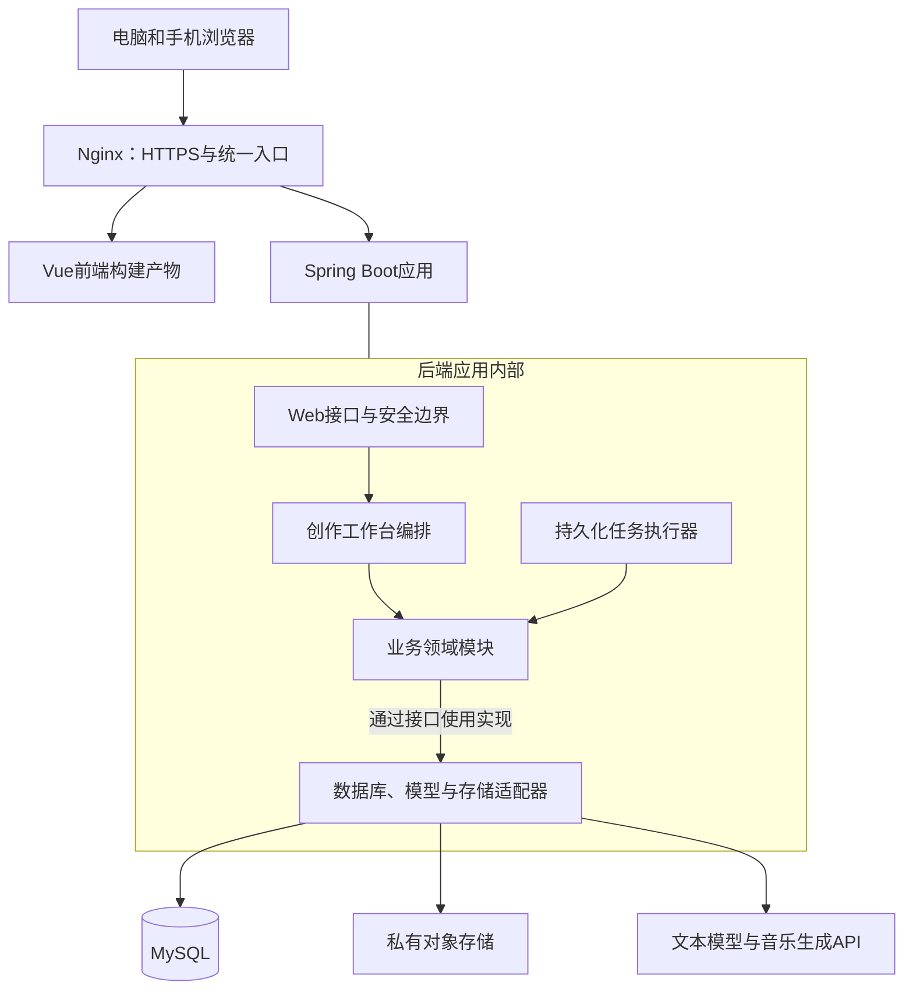
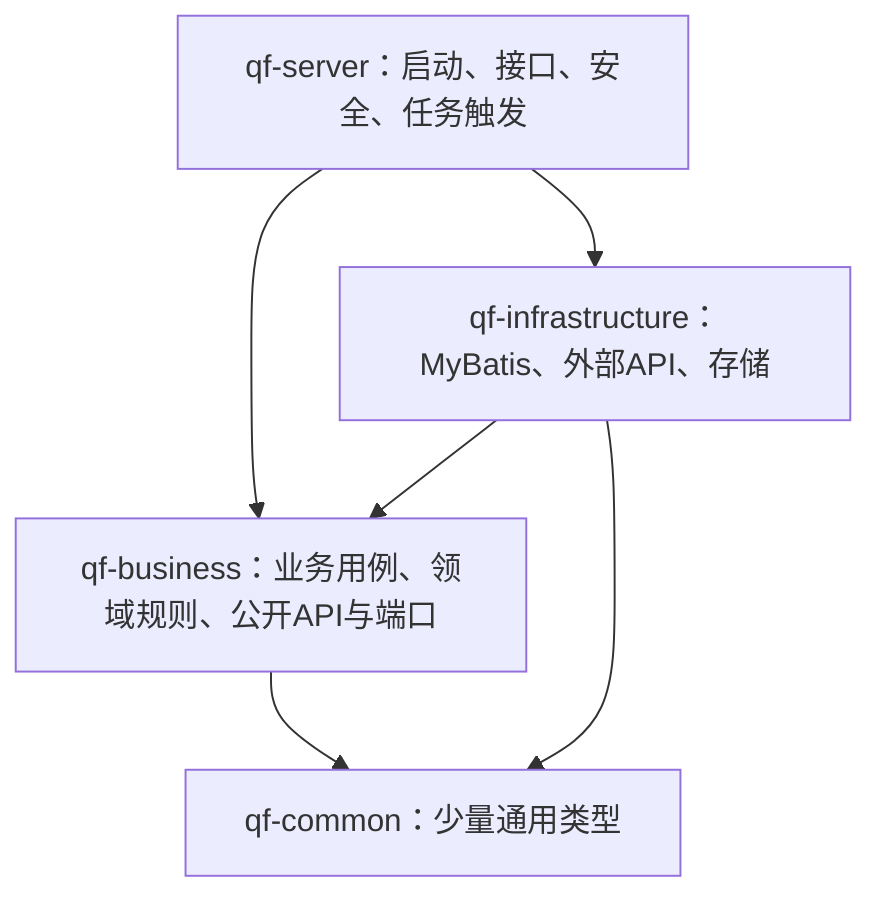
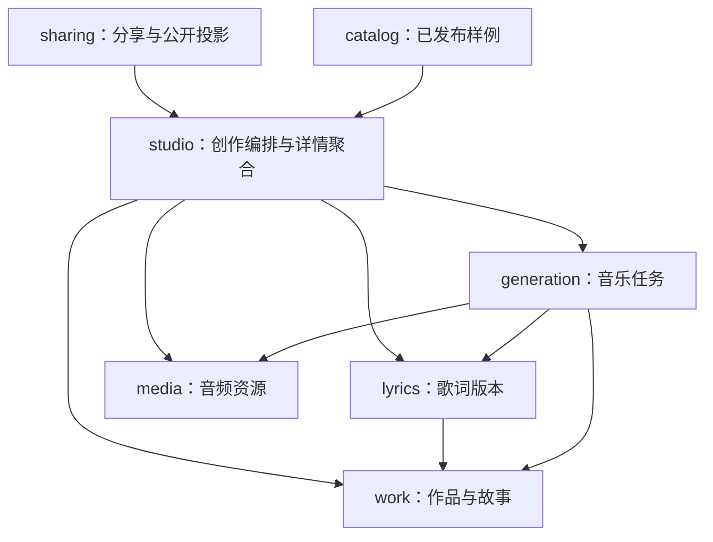

# 青风音乐模块架构设计（评审稿）

状态：2026-11-02 已完成四个Maven模块与Vue业务模块，支持会话/找回、草稿、手动歌词、音频与分享；任务租约/恢复/归档已离线验证，OSS已适配但缺实测配置。完整架构仍包含真实供应商、云端和部署等未验收目标；当前范围见 [第三阶段验收](第三阶段验收.md)。`ui-prototype` 保留已确认UI参考。

## 1. 架构决策

Vue 3 + TypeScript 前端，Spring Boot + MyBatis + MySQL 后端。采用模块化单体：四个 Maven 子模块，业务领域在 business 内分包；初期仅 server 启动一个 Java 应用。业务模块不是独立服务，也不是各自拥有一个数据库。

优先把边界、依赖、数据所有权和长任务可靠性设计清楚。暂不增加网关服务、注册中心、分布式事务、消息队列或通用工作流引擎。后续依据流量、组织职责或运行资源需要拆分。

## 2. 部署视图



浏览器不接触供应商密钥。大音频原则上经后端授权后使用短期存储签名地址传输，后端不长期中转全部音频流量。分享授权与存储公开访问权限分开管理。

## 3. Maven模块与编译依赖

箭头表示编译依赖。运行时由 Spring 注入 infrastructure 实现，因此业务不需要反向依赖适配器。



| 模块 | 负责 | 边界 |
| --- | --- | --- |
| qf-common | 通用标识、基础分页、非业务异常基础类型 | 不放 WorkDTO、用户表、Mapper、供应商对象或业务 Service |
| qf-business | 创作编排、业务领域、跨模块 API、仓储/服务端口 | 不直接依赖 MyBatis、对象存储 SDK、供应商 SDK 或 Web 请求对象 |
| qf-infrastructure | 实现业务端口；MyBatis 映射、SQL、模型接口、文件存储、数据库迁移 | 不决定业务状态如何流转，不对 Web 层提供可绕过业务的入口 |
| qf-server | 启动装配、Controller、Web DTO、安全过滤、配置、调度触发、健康检查 | 不堆业务流程，不直接调用 Mapper |

application 层可使用 Spring 事务；domain 层保持普通 Java 规则。原子业务状态变更放在短事务中，调用供应商与保存大文件不占用数据库长事务。

## 4. 业务领域划分

| 分包 | 主要职责 | 核心数据所有权 | 首阶段范围 |
| --- | --- | --- | --- |
| studio | 面向前端的跨领域用例编排、详情聚合与当前进度 | 不建立第二份作品/任务主表 | 创建草稿、保存歌词、提交生成、聚合详情 |
| identity | 创建者身份、匿名会话、后续账户与角色 | creator、creator_session；正式账户按迭代增加 | 最小匿名身份、所有权上下文 |
| work | 故事、对象、场合、祝福、作品归属与编辑规则 | music_work | 创建、编辑、读取草稿 |
| lyrics | 歌词生成、版本、确认；生成所需歌词快照 | lyric_revision；歌词生成任务记录可先复用任务基础表并由本领域管理 | 生成、修改、确认不可变版本 |
| generation | 音乐任务状态机、尝试记录、领取、恢复、重试与并发限制 | generation_task、generation_attempt | 提交、查询、保存阶段与失败处理 |
| media | 媒体元数据、类型/大小检查、文件登记、授权访问签名 | media_asset | 音频保存、播放/下载地址 |
| sharing | 收礼链接、分享快照、启停、有效期、公开字段投影 | share_link、分享快照 | 主动分享、只读收礼页、撤销 |
| catalog | 可公开展示的样例作品与场景配置；后续精选发布管理 | showcase_entry、scene_config | 已审核静态配置或最小发布记录 |

studio 是应用编排入口，不是通用工作流引擎。identity 的 Web 认证提取由 server 安全层负责，领域只接收可信创建者标识。catalog 不等于用户全部作品列表；私有作品不自动进入首页。

## 5. 业务依赖规则

以下为核心协作关系。所有横向调用只走对方 api 包；media 的通用使用和 identity 的认证上下文没有展开全部连线。



- work 不调用 generation 获取任务状态；作品详情由 studio 聚合，避免反向依赖。
- work 只管理作品本体和编辑规则；生成状态只由 generation 管理。
- 分享只读取可分享结果并生成白名单字段/快照，不向公开端返回整个作品详情对象。
- 各领域只修改自己拥有的数据。禁止跨领域直接注入 Mapper、Repository 实现或访问其表。
- 数据库外键、索引和事务按实际访问设计；共享一个数据库不表示可以绕过 API 边界。
- 依赖保持有向无环。可以通过 Spring Modulith 或 ArchUnit 在构建中校验 API 边界和循环依赖；选型须匹配 Spring Boot 版本，当前尚未引入。

## 6. 后端目录

```text
Qingfeng_AI_Music/
├── pom.xml                         父工程与依赖版本管理
├── qf-common/
├── qf-business/
│   └── src/main/java/com/qingfeng/music/
│       ├── studio/
│       ├── identity/
│       ├── work/
│       ├── lyrics/
│       ├── generation/
│       ├── media/
│       ├── sharing/
│       └── catalog/
├── qf-infrastructure/
│   └── src/main/
│       ├── java/com/qingfeng/music/infrastructure/
│       │   ├── persistence/         各领域Repository实现、Mapper和PO
│       │   ├── provider/text/       文本模型适配
│       │   ├── provider/music/      音乐服务适配
│       │   ├── storage/             对象存储适配
│       │   └── security/            会话持久化/密码算法等适配
│       └── resources/
│           ├── mapper/
│           └── db/migration/
├── qf-server/
│   └── src/main/java/com/qingfeng/music/server/
│       ├── MusicApplication.java
│       ├── web/app/                 创建者接口
│       ├── web/publicapi/           样例与收礼接口
│       ├── security/                认证过滤与Web权限入口
│       ├── scheduler/               调度触发与有界执行器
│       ├── config/
│       └── exception/
├── deploy/                         环境变量模板和部署描述
└── docs/
```

每个领域内按需要使用以下结构，简单领域不必机械创建所有目录：

```text
generation/
├── api/                            跨模块Facade、稳定DTO
├── application/
│   ├── service/                    提交、查询、领取、保存等用例
│   └── port/                       TaskRepository、MusicProvider等接口
└── domain/                         任务模型、状态与转换规则
```

类型边界：Web Request/Response 在 server；跨模块 API DTO 在领域 api；领域模型在 domain；数据库 PO 在 infrastructure.persistence；供应商 DTO 在 infrastructure.provider。不要将 Entity 原样返回公开接口。

## 7. 前端结构与依赖

```text
Qingfeng_AI_Music_VUE/
├── package.json
├── vite.config.ts
├── src/
│   ├── app/                        启动、路由、布局、全局样式
│   ├── modules/
│   │   ├── home/                   品牌首页、场景和精选试听
│   │   ├── studio/                 创作表单、歌词编辑和生成等待
│   │   ├── works/                  私有作品列表、详情和版本
│   │   ├── gift/                   收礼页面、分享设置
│   │   └── identity/               当前创建者与后续登录
│   ├── shared/
│   │   ├── ui/                     Button、Dialog、空状态等基础组件
│   │   ├── player/                 跨页面播放器、播放队列与状态
│   │   ├── http/                   HTTP封装、错误映射、会话处理
│   │   ├── assets/                 品牌素材和全局字体样式
│   │   └── types/                  非业务基础类型
│   └── main.ts
└── tests/                          核心流程与组件行为
```

每个业务模块内组织 pages、components、api、model、composables，按复杂度按需增加。业务 DTO 放各模块 api/model 内；跨模块稳定能力从 index.ts 导出，不深层引用别人的内部组件。依赖方向为 app → modules → shared；shared 不反向引用 modules。全站播放器放 shared/player，避免每个页面各有一个 Audio 实例。

前端模块对应用户使用场景，后端模块对应业务所有权，不要求一一同名。未完成任务与真实作品以服务端为准，Pinia 只负责浏览器交互和缓存。正式后台在业务需求明确后增加 admin 入口/独立前端，不提前实现空目录。

## 8. 真实请求链路

```text
Vue创作页
 → /api/app/studio 接口
 → StudioFacade
 → WorkApi 检查归属与草稿
 → LyricsApi 取得已确认版本
 → GenerationApi 创建不可变生成快照与任务
 → MySQL提交成功，返回任务编号
 → 后台任务领取任务
 → MusicProvider端口 / 供应商适配器
 → 保存供应商任务编号、轮询状态
 → MediaApi登记资源 / StoragePort保存音频
 → GenerationApi标记成功
 → 前端查询聚合详情并播放
```

分享由用户单独触发：分享接口 → SharingApi → 读取已完成结果并保存分享快照 → 返回随机分享标识。公开读取接口仅返回标题、收件人、祝福、歌词、封面和授权音频信息。

## 9. 可靠性与权限约束

1. 任务状态至少包括 QUEUED、SUBMITTING、RUNNING、SAVING、SUCCEEDED、FAILED、SUBMISSION_UNKNOWN。
2. 请求幂等键 + 唯一约束防止重复创建。任务领取使用数据库条件更新和有时限的执行租约，更新状态携带拥有者/版本条件。
3. 不宣称能与供应商实现严格 exactly-once。提交超时须通过供应商幂等能力/任务查询/请求追踪进行确认；无确认能力时进入待处理状态，不自动重复付费生成。
4. SAVING 阶段只重试音频归档，禁止再次生成。供应商返回的临时音频链接不作为永久资源地址。
5. 初期通过数据库恢复任务；进程内事件/线程池不能成为唯一可靠记录。未来跨进程事件使用持久化 outbox 和幂等消费。
6. 创建者身份来自服务端认证上下文，不能信任前端提交的 ownerId。随机分享标识仅授权收礼只读能力，不授权编辑或生成。
7. 关闭/到期的分享链接不再签发新地址；已签发存储URL在过期前仍可能访问，使用短有效期管理这一窗口。
8. 数据库事务保持短小，外部 HTTP 与文件传输在事务外执行。应用层负责编排事务，领域规则不依赖 HTTP、MyBatis 或存储SDK。
9. 日志记录任务编号、阶段、耗时、供应商追踪标识与安全错误码；不记录密钥、完整敏感故事或带签名音频URL。

## 10. 后续扩展

- 账户与权限：扩展 identity，复用当前 creator 归属关系。
- 商业化：新增 billing 领域，拥有订单、额度账本和扣退规则；通过 GenerationAdmissionPolicy 等窄接口接入，不让生成模块反向耦合订单实现。
- 发布运营：扩展 catalog，新增管理端Controller和前端入口；审核、发布、撤销不改变私人作品默认可见性。
- 通知：新增 notification 领域，消费可靠的完成事件；不要让 generation 同步依赖邮件/SMS实现。
- 增加供应商：在 infrastructure/provider 增加端口实现，不修改页面协议。
- 扩大任务量：增加 qf-worker 启动模块复用 business 与 infrastructure，通过配置关闭 server 内的领取执行；避免两边无控制地重复跑任务。队列按实际容量需求引入，业务任务表保留。

第一阶段实现上述边界内的最小可用功能，不要求三天内实现正式账号、订单、会员、消息队列或运营后台。

## 参考

- Spring Modulith 模块、公开接口和内部实现：https://docs.spring.io/spring-modulith/reference/fundamentals.html
- 模块循环依赖与接口边界校验：https://docs.spring.io/spring-modulith/reference/verification.html
- Vue Router 路由懒加载：https://router.vuejs.org/guide/advanced/lazy-loading.html
