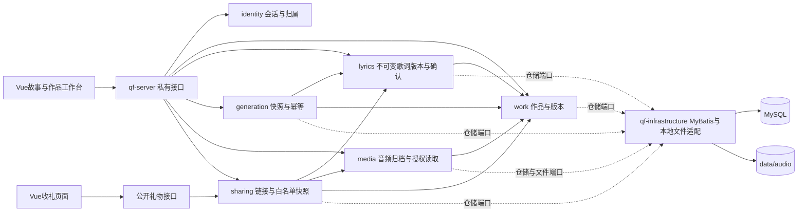

# 第二阶段：歌词、已有音频与礼物分享

日期：2026-10-31。用户指示音乐模型不通时继续其他任务，本轮没有新增模型请求。当前完成的是本地手动歌词和已有音频闭环，真实AI生成验收仍未完成。

后续进展：本文是第二阶段历史记录，下文未完成项中多项已在第三阶段补齐，当前范围请以[第三阶段验收](第三阶段验收.md)为准。

## 可以体验的流程

1. 后端执行`Qingfeng_AI_Music/scripts/build.ps1`和`run-mysql.ps1`，前端执行`npm run dev`。
2. 打开`http://127.0.0.1:5173`，进入制作歌曲，填写对象、场合、故事与风格并保存。
3. 进入作品详情，填写标题和手动歌词，保存为独立版本，再确认此版本。修改已确认歌词时需要另存新版本。
4. 上传自己有权使用的MP3/WAV（最大20MB）。试听或下载，确认音频和歌词匹配后创建礼物链接。
5. 在隐私窗口打开链接，免登录查看品牌封面、祝福、歌曲名称、歌词并试听下载。公开内容不包含原始故事。
6. 回作品详情撤销本作品全部分享。旧链接再次读取信息和音频均不可用。已经接收或下载的内容不能远程收回。

个人作品地址：`/works`及`/works/{id}`；礼物地址：`/gift/{token}`。本地链接用于当前电脑，尚未部署到公网。

## 现在的模块与调用关系

图中的虚线是运行时端口调用；代码依赖仍为infrastructure依赖business提供的接口，不让business引用MyBatis或本地文件实现。studio保留跨模块编排位置，catalog保留样例目录位置，当前没有为占位模块虚构服务。

## 数据与访问边界

| 对象 | 本轮实现 |
| --- | --- |
| lyric_revision | 歌词正文按新记录保存，确认不覆盖正文；绑定作品版本，作品已改时需要为当前版本另存歌词 |
| media_asset | 保存归属、来源IMPORTED、字节数、SHA256、服务端文件名；不接受客户端路径作为存储路径 |
| share_link | 随机256位令牌，仅存哈希；7天到期；冻结创建时标题/对象/祝福/歌词和音频引用；可按作品全部撤销 |
| generation_task | 冻结确认歌词/标题/风格/作品版本；作品与请求标识唯一；同请求重发返回原记录，换歌词不能复用同标识 |
| 个人读写 | Cookie创建者会话、写请求CSRF、每次按作品校验归属；其他会话的作品/歌词/音频不可读取 |
| 礼物读取 | 仅持有效令牌可以公开GET信息和音频；不输出创建者身份、原始故事、内部存储路径或修改接口 |

上传流经过20MB上限、WAV/MP3容器头检查、SHA256和临时文件原子落盘。数据库登记失败时清理本次文件；服务在文件落盘和登记之间突然终止仍可能遗留孤儿文件，尚未做清理任务。没有完整解码、转码或病毒扫描。默认目录是后端工作目录下`data/audio`，可通过`qingfeng.media.directory`设置绝对路径。

任务插入使用数据库唯一约束配合重复键读取，事务采用READ_COMMITTED，避免MySQL可重复读事务看不到竞争方刚提交的任务。H2集成测试验证并发提交；本机MySQL已验证业务迁移与页面闭环，尚未进行生产规模并发压测。

## 验收证据

- 后端17项自动化测试：领域状态3项、无库/安全入口3项、会话和草稿4项、歌词/音频/分享5项、任务并发与快照2项。
- 前端：类型检查、生产构建、3项平台测试通过。
- 本机MySQL：Flyway V1—V3真实迁移；页面保存和确认歌词、WAV上传与刷新恢复通过。
- 浏览器：个人与收礼播放器均观察到真实时间推进；音频Range返回206、12字节片段符合请求；下载响应为attachment。
- 独立无Cookie浏览器上下文可收礼；返回公开内容不含测试私密故事；撤销后元数据和音频均404，页面呈现不可用状态。
- 作品详情与礼物页1440/390/320像素无横向溢出，已人工检查截图。手机检查是桌面Chrome模拟视口，尚未用iOS Safari/Android真机补验。
- 临时过程文件：`.cache/qa-gift-workflow.mjs`、`.cache/gift-qa-result.json`、`.cache/screenshots/`，均在Git忽略范围。浏览器验收使用项目器乐样曲作为明确标识的导入测试文件，未作为真实AI音乐验收。

## 仍需完成

1. 歌词/音乐供应商真实成功调用；当前运行时只有UnavailableMusicProvider，填入密钥也不会自动开启生成。
2. 任务领取、租约、供应商提交/查询、提交结果未知处理、失败重试与重启恢复。现有任务快照和幂等不能代表执行器已经完成；必须补齐后再启用真实provider。
3. 供应商结果音频下载归档与仅归档重试。当前只实现用户上传已有音频归档，没有从模型临时链接自动下载。
4. 阿里云OSS适配、公网HTTPS部署及真机回归；App按用户当前决定暂缓。
5. 匿名身份跨设备恢复、存储容量/请求频率限制、孤儿文件整理等后续运维能力。

原计划检查点B仍未通过；本轮完成检查点C中本地试听、下载、作品和分享部分，不包含真实AI歌曲或在线Web/H5交付。模型调用累计保持歌词POST 1次（429配额不足）、歌曲POST 0次。
