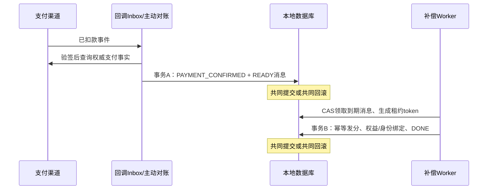

# 支付确认与积分发放的 Outbox 最终一致性参考实现

这是可编译的 Java 17 / Spring JDBC 参考模块，不属于后端启动模块，不注册生产 Bean，不包含自动执行的 Flyway 迁移。SQL只定义 demo_ 表。未修改生产支付状态机、配置或主库。

## 当前项目事实

StripePaymentService.settle 已经在同一 TransactionTemplate 中调用完整 ledger.credit、更新订单PAID并绑定支付身份。因此不能把当前实现说成“先提交PAID再单独发分”。现有 PaymentInbox 负责先持久化验签后的回调，task_event_outbox 负责持久化唤醒；两者与本参考中“待发分意图”职责不同。

采用异步发分意味着引入“已确认收款、尚未发分”这一明确业务状态，不能只把同步 credit() 换成异步调用。建议先保留现有原子结算，再根据解耦、吞吐和恢复需求决定是否迁移。本参考提供用户请求的完整核心机制，不自动改变现有行为。

## 事务与状态



- 订单：PENDING → PAYMENT_CONFIRMED；消息：READY → PROCESSING → DONE。发起支付阶段只建立PENDING订单，不能产生可执行发分消息。
- 失败：PROCESSING → READY，指数退避+jitter；到阈值 → DEAD，并同事务插入demo_credit_alert。宕机未记失败也计入claim attempts，防止崩溃无限重试。
- 失败/取消通知不得把PAYMENT_CONFIRMED订单回退；退款、争议使用独立的已验证财务事实，不能简单撤销状态后重跑本消息。
- 一个订单一个消息；同一provider/merchant/environment/capture只能归属一笔订单。上线DDL必须给外部身份字段使用与现有财务表一致的二进制区分大小写规则，不依赖数据库默认排序规则。

## 核心文件与默认参数

- `src/main/resources/schema.sql`：订单简化模型、Outbox、告警表及索引。生产必须确认全部表为InnoDB。
- `src/main/java/example/payment/CreditGrantOutbox.java`：Entity record、事务A、数据库分布式租约、事务B、重试、扫描。
- 构造参数建议：maxAttempts=10，initialDelaySeconds=180，leaseSeconds=60。每10秒扫描，每轮最多20个任务；每个消费事务超时20秒。实际部署应按连接池、后台负载与SLO调节。
- 初次可执行时间是提交后3分钟，所以默认方案会有约3分钟发分延迟。这是明确的补偿等待策略，不适合要求秒到账的主路径。秒级主路径可把初始delay改为0并用已有task_event_outbox/MQ唤醒，3分钟扫描作为兜底。MQ消息只携带orderId，不携带可信积分金额；MQ ACK应在事务B提交后。

## 为什么数据库租约也是分布式锁

所有实例竞争同一数据库行，CAS更新PROCESSING+唯一lease_token，仅一个实例获胜。长时间暂停的旧实例恢复后，必须在事务B持有消息行锁、验证token及lease有效后，才能触碰账本。租约过期可被其他实例领取；任务处理中保持短事务行锁，重领会等待事务结束并重新检查条件，不会与旧事务并行提交。

Redis SET NX / Redisson 可作为减少竞争的外层优化，但Redis锁过期、进程暂停或故障切换不能单独保证资金一致性。数据库fencing、支付身份唯一约束、账本幂等及本地原子事务仍必须保留。本实现不引入Redis服务依赖。

所有数据库时间取数据库CURRENT_TIMESTAMP，不比较应用服务器时钟。锁顺序统一 owner → order → message → ledger/entitlement。claim事务只锁消息，提交后才进入资金事务。

## 生产适配边界

1. VerifiedPayment只允许由已有验签+渠道权威查询服务构造；不能将公开HTTP请求body直接映射为VerifiedPayment。校验金额、币种、商户、环境、order/checkout/capture映射及用户归属，HTTP渠道调用必须在资金事务外完成。
2. Credits.grantAndBind必须与Outbox使用同一DataSource和事务管理器，使用REQUIRED加入事务B。适配到项目现有fenced ledger.credit(owner, credits, "payment:"+orderId)以及原有bindPayment，不得裸改credit_account、只写credit_ledger、跳过权益批次、退款争议机制或writer协议。demo_ledger仅为测试替身。
3. 把demo_owner映射到creator；生产锁顺序与现有路径保持一致。独立注册worker Bean并启用Scheduling；参考代码没有@Component，默认不会运行。
4. 当前退款/争议路径可能假定PAID已发分。迁移时必须为待发分订单定义退款、冻结、争议与补发的串行策略，保留统一owner锁及退款身份幂等；不能让异步补发绕过已退款/冻结事实。未完成适配不能接入生产。
5. 旧PAID订单不能批量生成全新积分reference重新发放。先对账，复用原payment:<id>及现有账本/批次/原生付款绑定，缺失或冲突进入人工复核。不得清空账本、重置付款身份或迁移旧快照覆盖新资金事实。
6. 本模块的payment capture唯一键是简化演示；生产需要复用现有全局原生付款身份注册和复合商户环境作用域，不能创建另一个互不约束的付款身份空间。

## 回调尚未落库就宕机的另一条缺口

Outbox只能补偿“本地已有收款确认事实”的订单。若渠道已扣款而本地事务A从未提交，必须依赖渠道回调重投和主动对账。后台分页扫描长时间PENDING/创建结果未知的订单，以已有渠道订单/幂等键查询权威支付事实；查询确认成功后调用同一个confirm()，不得重新扣款或根据客户端返回页推断成功。渠道超时表示UNKNOWN，继续有界重试并告警，不自动标失败。

对账任务同样需要数据库租约/分页/退避/商户环境隔离，不能持有资金行锁调用渠道API。当前项目已有渠道恢复查询与Inbox worker，应复用它们，不另建绕过验证的收款入口。

## 宕机演练（仅隔离环境）

A. 在paymentCommitted断点处暂停。此回调由TransactionSynchronization.afterCommit执行，日志为PAYMENT_COMMITTED_GRANT_PENDING。此刻事务A已实际提交，订单PAYMENT_CONFIRMED、消息READY、账本无对应积分。在另一个终端强制终止测试进程；用同一隔离持久化数据库重启worker，超过next_attempt_at后自动发分并DONE。

B. 在CrashProbe.claimed断点暂停再终止进程。消息保持PROCESSING；重启后等待数据库lease_until过期，获得新token后补发。尝试让旧worker恢复执行，应返回false，不得发分或覆盖新token。

C. 在creditedBeforeDone断点暂停再终止进程。积分变化仍在未提交事务B中，数据库应回滚，消息保持之前已提交的PROCESSING。租约到期重领后只发一次。不能仅抛出普通异常便宣称完成了真实kill -9演练。

D. 在事务B提交后、调用者收到结果前终止进程。重启后消息DONE，不再发分；重复投递相同订单也不能改变DONE。注意断点位于事务内部并不表示事务已提交。

断点仅提供测试注入接口；无Runtime.halt/System.exit生产开关，不输出密钥、完整回调或用户隐私数据。

## 告警与人工恢复

失败记账采用独立事务，不能与失败的资金事务一起回滚。重试耗尽与持久告警原子提交；扫描器对未确认告警反复输出ERROR CREDIT_GRANT_DEAD，运维必须为此配置日志/指标告警和响应人。没有配置告警平台不能宣称已通知运维。参考代码不发送邮件或外部消息。

监控：READY最老等待时间、PROCESSING租约超时数、DEAD数量、PAYMENT_CONFIRMED未发分时长、扫描失败、渠道与账本对账差异。失败记录只存异常类型，敏感异常详情应由受控日志另行处理。

人工恢复应在查明原因、核对权威付款/退款/争议及已发分流水后，将同一DEAD任务受控恢复为READY，保留审计和原payment:<id>；严禁换新幂等键强制补发。恢复与告警确认需同事务、带操作者和理由，不能直接批量清零重试数掩盖问题。

## 验证

```powershell
mvn -f examples/payment-credit-outbox/pom.xml test
```

10项隔离H2测试覆盖：外层事务回滚、重建worker补发、50竞争任务只发一次、过期token拒绝、积分写入后事务异常回滚、退避、3分钟延迟、反复宕机重领达到阈值、DEAD告警、付款身份跨订单重复和金额不匹配。

这是核心逻辑验证；没有执行真实进程强杀、MySQL多实例并发/死锁演练、Redis故障、生产迁移或线上支付验收。H2不能代替InnoDB的锁语义验证。H2 2.4测试保留建表连接到用例结束，避免常量集合CHECK表达式引用已关闭建表Session；不改变业务约束。

参考：[Spring事务](https://docs.spring.io/spring-framework/reference/data-access/transaction/programmatic.html)、[MySQL锁定读](https://dev.mysql.com/doc/refman/8.0/en/innodb-locking-reads.html)。
