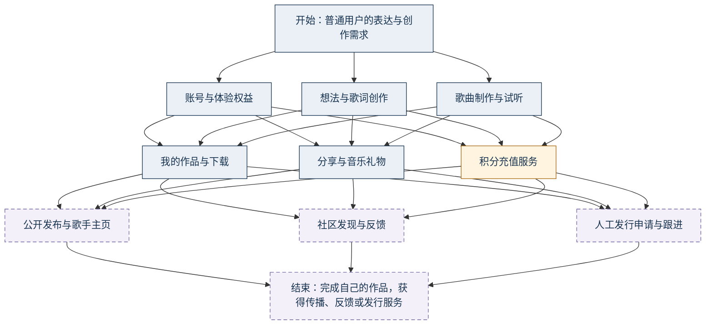
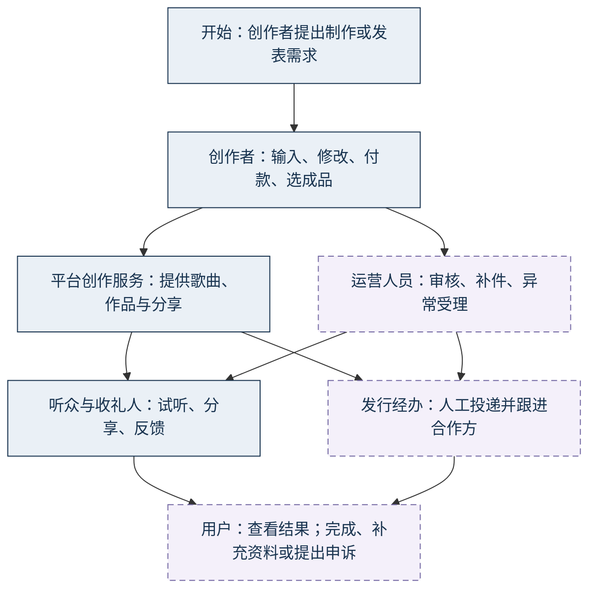
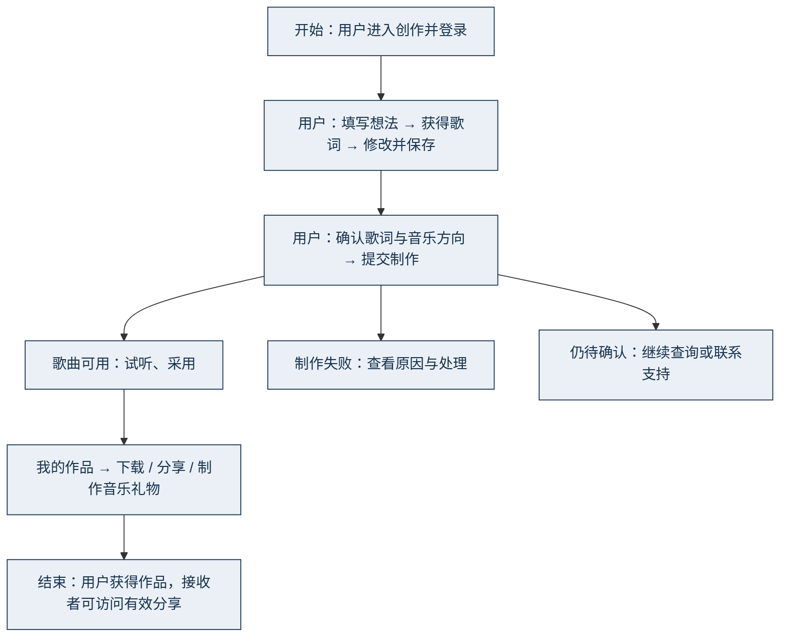
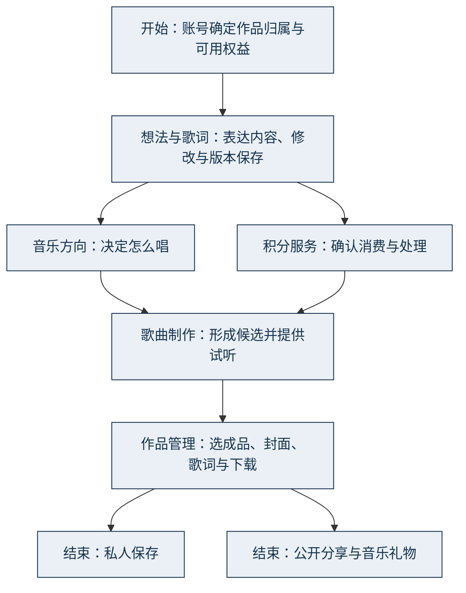
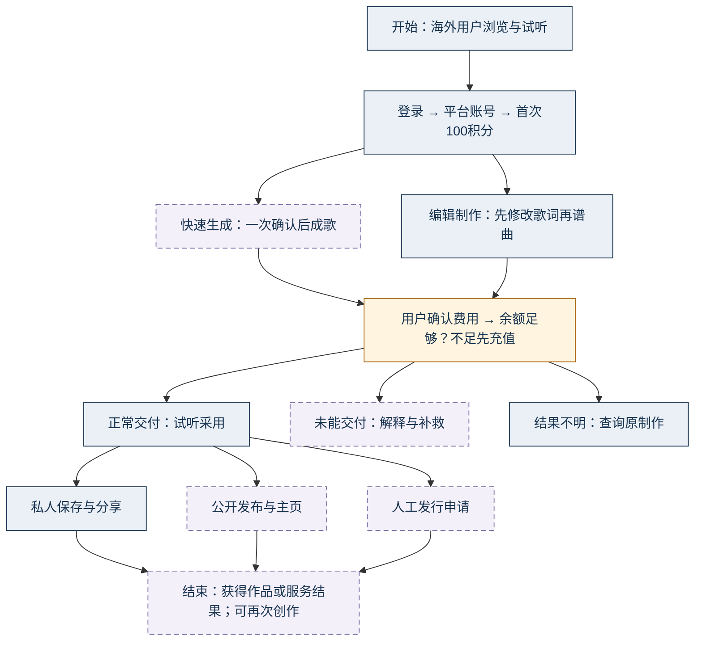
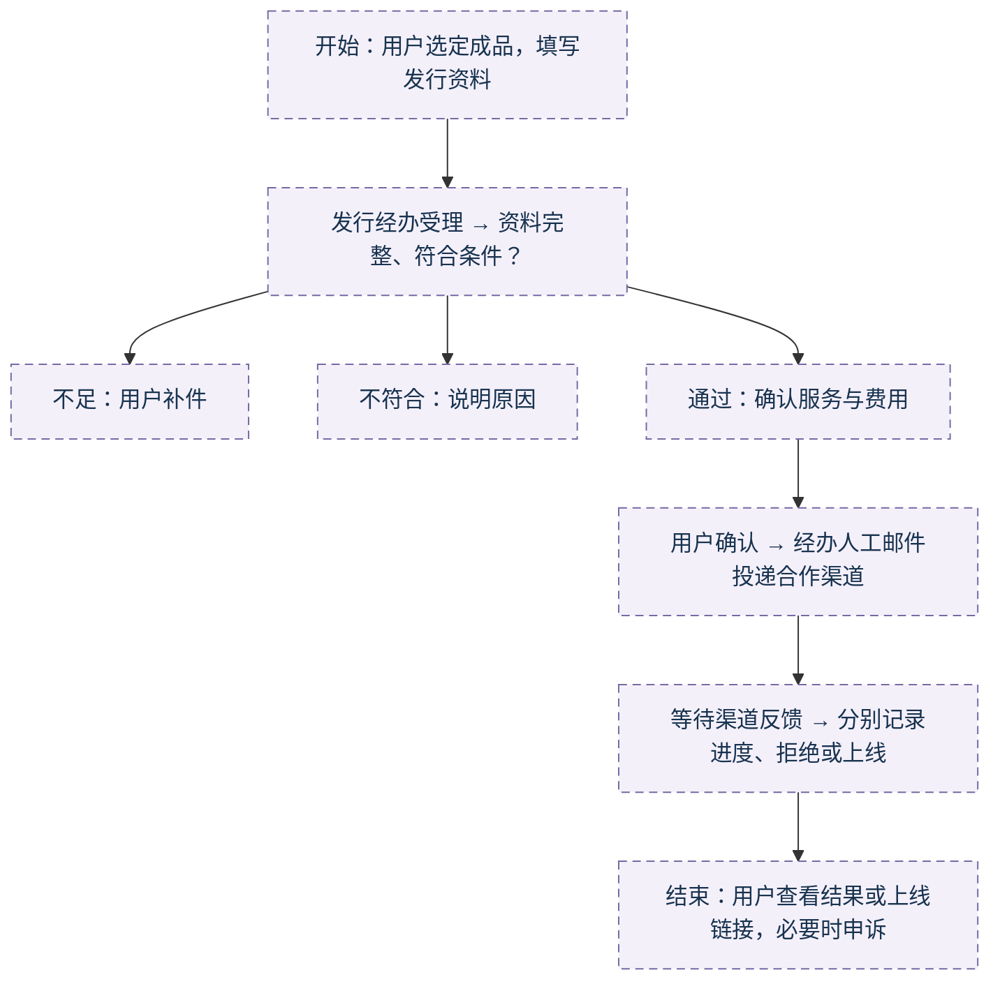
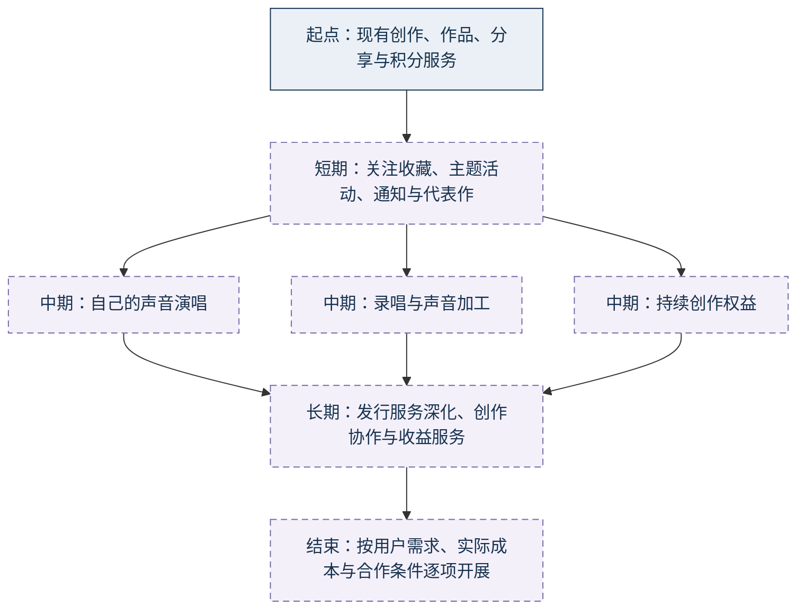

# 项目业务功能梳理与上线规划方案
汇报日期：2026年11月9日；首期目标：2026年12月7日。

## 项目业务功能梳理与上线规划方案

人人都是歌手 · 面向海外用户的音乐创作与发布平台

汇报日期：2026年11月9日    首期目标：2026年12月7日

> 本次需要形成的决策：首期上线什么、已有业务还需补齐什么、哪些优化优先做、哪些发展方向放到后续。

以已经形成的创作与作品管理能力为基础，优先完成“登录—创作—付费—交付—分享发布—发行申请”的业务闭环。

第一版会议材料 · 业务现状核对截至2026年11月8日

## 阅读导航与核心判断

| 章节 | 管理层需要了解什么 | 页码 |
| --- | --- | --- |
| 第一章 业务概述 | 平台定位、服务对象与功能地图 | 3 |
| 第二章 业务现状 | 哪些已有、哪些待补；角色与当前流程 | 4—8 |
| 第三章 首期范围 | 12月7日前提供哪些服务，如何完成 | 9—14 |
| 第四章 未来拓展 | 短期、中期、长期的业务发展 | 15 |
| 第五章 已有功能优化 | 如何让现有功能更好用 | 16—17 |
| 第六章 当前业务问题 | 已经发现的衔接与规则缺口 | 18—19 |
| 第七章 管理决策 | 首期边界、完成标准与负责人 | 20—21 |

> 核心判断：现有基础足以支撑编辑式创作，不应推翻重做；快速成歌、账号绑定、公开社区与人工发行跟进，需要按首发目标补齐。

现状分级反映目前核对到的业务能力；付款、海外登录与全面开放等条件仍需业务负责人确认。规划能力不作为当前已开放服务宣传。

## 第一章｜业务定位与功能地图

已有能力继续完善；黄色表示可销售或对外开放条件仍待确认，虚线表示规划补齐。

服务对象：希望低门槛创作的普通用户、愿意修改歌词的创作者、收礼人与听众，以及希望进一步发表作品的用户。商业价值来自制作服务与后续发行服务，不依赖用户先具备专业音乐知识。

## 第二章｜当前业务功能现状（一）

| 业务模块 | 具备程度 | 当前用户能够做什么 | 还需确认或补齐 |
| --- | --- | --- | --- |
| 登录与账号 | 基本具备 | 已有Google、邮箱和手机登录入口及相关操作。 | 目标地区可用性；同一账号自主绑定多种方式。 |
| 首次100积分 | 基本具备 | 首次有效登录可获得体验权益，并有到账提示。 | 全部登录方式的重复领取控制与权益说明。 |
| 想法与歌词 | 已具备 | 填写想法、辅助改写、生成歌词、手动修改、保存和查看版本。 | 海外用户首次使用体验与免费使用规则。 |
| 编辑后谱曲 | 基本具备 | 确认歌词、调整音乐方向、发起制作并查看结果。 | 真实交付质量、费用规则和失败处理验收。 |
| 快速成歌 | 尚未具备 | 当前主要路径仍先生成歌词，再进入编辑与歌曲制作。 | 补一次确认后自动完成歌词与歌曲的完整体验。 |

“已具备”表示对应业务操作已经形成；“基本具备”表示主要操作存在但配套条件未齐。“部分具备”只有部分环节；“尚未具备”未找到完整可用能力；“待确认”不能据现有信息判断。

## 当前业务功能现状（二）

| 业务模块 | 具备程度 | 现有能力 | 首发关注点 |
| --- | --- | --- | --- |
| 作品与试听 | 基本具备 | 作品列表、版本试听、音频选择、下载、封面和歌词展示。 | 候选数量、部分结果可用及最终采用规则。 |
| 分享与礼物 | 基本具备 | 生成歌曲分享、展示歌词封面、有效期与撤销。 | 接收者无需内测资格即可收听；长期作品地址另定。 |
| 积分与充值 | 部分具备 | 余额、制作消费、部分失败退回、美元套餐与充值操作。 | 正式收款条件、充值中断、退款及争议处理。 |
| 公开社区 | 尚未具备 | 现有试听展示和分享不等于用户发布社区。 | 发布审核、歌手主页、发现列表、下架与举报。 |
| 人工发行服务 | 部分具备 | 人工邮件做法已明确；站内受理到结果查询尚需补齐。 | 申请、补件、经办人、邮件记录和渠道结果。 |

> 重要区别：已有按钮或展示，不等于商业服务完整。当前“对外收款是否可正式开展”和“海外目标用户是否全部可用”列为待业务确认。

## 用户角色与业务协作关系

本图展示首发目标下的协作关系。新增加的审核和发行管理环节采用虚线样式。

创作者决定内容与公开范围；运营人员处理公开内容和用户异常；发行经办跟进渠道，不替用户承诺权利归属。听众转为创作者时，同样走登录与体验流程。

## 当前核心业务流程与模块衔接

想法、歌词、歌曲、作品管理和分享已有衔接；当前尚不等于“输入后直接自动成歌”。

作品、歌词版本、封面与音频关联展示；分享引用选定成品，不应随编辑中的修改自动改变。积分服务与歌曲制作关联，公开发布和人工发行是首期需补齐的两条后续服务。

## 现有业务模块如何衔接

以当前业务为基础：账号承接权益，歌词与方向决定作品，制作形成结果，作品管理连接保存和分享。

模块衔接的业务约束：制作使用确定版本；已分享内容不能因编辑中的修改而自动改变；查询原制作和恢复原结果不应被算作一次新的购买。公开社区和发行是在此基础上的首发延伸，尚不算已具备。

## 第三章｜12月7日前的上线范围

| 业务模块 | 首发具体功能 | 当前程度 | 上线前完善 | 优先级 / 必要性 |
| --- | --- | --- | --- | --- |
| 账号与权益 | 三登录、绑定、首次100积分 | 基本具备 | 目标地区、绑定引导、权益规则 | P0 / 必需 |
| 音乐创作 | 快速生成＋先改歌词再制作 | 部分具备 | 快速闭环、报价与阶段恢复 | P0 / 必需 |
| 充值与交付 | 购买积分、制作消费、结果查询 | 部分具备 | 真实收款与异常、退款支持 | P0 / 必需 |
| 分享与公开发布 | 分享、审核、主页、发现与下架 | 部分具备 | 公开发布及内容处理闭环 | P0 / 必需 |
| 人工发行 | 填表、审核、人工邮件与结果 | 部分具备 | 受理、补件、经办和渠道记录 | P0 / 必需 |
| 海外服务与客服 | 英文操作、通知、帮助与申诉 | 部分具备 | 地区、渠道与处理责任 | P0 / 必需 |
| 互动与便利功能 | 收藏、关注、完成通知、精选 | 尚需补充 | 先保障核心，再增加辅助 | P1 / 建议 |

必要性：账号承接资产；创作交付核心价值；充值支持商业服务；分享发布支撑传播；发行申请兑现首发承诺；运营与客服让异常能被处理。P2能力不影响首期闭环，后续再推进。

## 首期上线业务总流程

首期新增环节与已有能力组合成完整服务；用户可以仅私人保存，不强制公开或发行。

## 创作：一次表达，两种参与方式

| 步骤 | 快速生成音乐 | 先生成歌词，自己修改 |
| --- | --- | --- |
| 用户表达 | 填写想法与语言，不要求用户写歌词。 | 同一输入页，先取得一版歌词。 |
| 用户确认 | 确认整次制作费用及自动写词授权。 | 修改、保存歌词，按需调整音乐方向。 |
| 平台服务 | 自动完成歌词与谱曲，统一展示进度。 | 使用用户确定的歌词和方向制作歌曲。 |
| 结果交付 | 进入同一试听页，允许后续修改。 | 试听、比较、选成品；修改时再次确认费用。 |
| 异常出口 | 保留输入和已完成内容；没有交付按规则退回。 | 保留已保存歌词；重做前说明范围与费用。 |

> 候选规则：快速与编辑后谱曲，基础制作均15积分。一次制作不等于保证一首满意成品；候选数量与完整性应在提交前说明。

标签默认空白、按需展开。明确文字要求仍有效；用户主动选择可以补充，明显冲突先确认。手动修改不自动产生正式版本，保存后再制作。

## 账号与付费：规则明确，用户少走弯路

| 环节 | 用户操作 | 平台或人员处理 | 完成结果 |
| --- | --- | --- | --- |
| 账号识别 | 任选方式登录，原账号内绑定其他方式。 | 验证控制权；未绑定新身份先提示，不静默合并。 | 进入同一账号；作品积分归属明确。 |
| 首次权益 | 查看100积分到账与消耗说明。 | 同账号只赠送一次；异常可查询处理。 | 用户理解可用权益。 |
| 制作消费 | 查看费用并明确确认。 | 按公开规则扣除或预占；失败按规则处理。 | 结果与消费明细可查。 |
| 积分不足 | 选择套餐及支付方式。 | 确认付款后到账，关页或延迟仍可核对。 | 返回原制作，用户再次确认继续。 |
| 退款申诉 | 提供订单或作品信息。 | 客服核对付款、消费与交付，反馈处理。 | 退积分与退款分别记录。 |

候选套餐：$4.99／100积分，$12.99／300积分，$24.99／700积分。首登100积分按15积分可做6次基础制作，剩10积分；其他加工另计。

待管理层确认：赠送有效期、预扣退回还是先预占后结算、免费写词次数、正式收款渠道与销售范围。当前主要做法是制作前扣除、部分失败退回，不宜宣传为已实行预占后结算。

## 分享、社区发布与管理人员操作

| 业务 | 用户路径 | 管理人员操作 | 完成标准 |
| --- | --- | --- | --- |
| 公开分享 | 选歌曲 → 创建链接 → 预览复制 → 发给朋友。 | 处理失效访问与投诉；不要求接收者注册创作。 | 无登录收听成功；私人内容未公开。 |
| 站内发布 | 选成品 → 完善艺名资料 → 确认公开范围 → 申请。 | 审核、退回补充或通过，处理下架与举报。 | 作品公开页、歌手主页与发现列表可见。 |
| 音乐礼物 | 选歌曲 → 填收礼人与祝福 → 预览分享。 | 支持有效期和撤销相关问题。 | 收礼人可看歌词封面并试听。 |
| 内容运营 | 查看他人作品，按开放功能互动。 | 维护最新或精选列表，组织小规模主题活动。 | 公开内容有人管理，推荐规则清楚。 |

> 首期社区做最小闭环：发布、审核、歌手主页、作品页、发现列表、下架和举报。收藏关注为P1；评论、私信、复杂榜单与个性化推荐后置。

临时礼物沿用期限；公开发布应有稳定作品地址。已有分享不是社区发布，不能用一条临时链接代替长期歌手作品展示。

## 人工发行：一键申请，人工跟进

全图为需补齐的站内服务目标。人工邮件做法已明确，不代表站内申请与跟进已形成。

必须记录：申请编号、确定成品、歌手与署名、素材授权、目标渠道、经办人、补件事项、发送记录与渠道结果。

对外称“一键提交发行申请”；已发邮件不等于发行成功。覆盖渠道、受理条件、收费、拒绝后的处理、预计时间均待业务确认，不承诺全球所有平台或保证上线。

## 第四章｜未来业务拓展

未来规划不挤占首发范围；先验证用户是否持续创作和愿意购买服务。

| 方向 | 场景与用户 | 预期价值及现有基础 | 阶段 |
| --- | --- | --- | --- |
| 歌手成长 | 创作者积累作品，听众追踪喜欢的歌手。 | 延伸作品与分享，提高回访和反馈。 | 短期 |
| 个人演唱 | 普通用户希望自己的声音出现在歌曲中。 | 延伸歌曲制作；需先验证效果、授权和价格。 | 中期 |
| 录唱与加工 | 愿意自己唱的用户需要伴奏、修音与混音。 | 延伸现有试听、歌词和音频服务。 | 中期 |
| 长期创作与发行 | 高频用户、协作者和希望发表的歌手。 | 在积分和人工发行成熟后扩展订阅、协作与收益服务。 | 中长期 |

## 第五章｜优化已有功能，而非重做（一）

| 当前功能 | 已有能力 | 现阶段不足 | 建议优化 | 价值 / 优先级 |
| --- | --- | --- | --- | --- |
| 音乐方向选择 | 风格、声音、乐器与补充要求。 | 未主动选择时仍可能带默认民谣及相关标签。 | 默认空白；保留明确文字要求，冲突确认。 | 减少误导，提高方向一致性 / 高 |
| 进入创作 | 登录后可继续创作。 | 用户刚进入创作就需登录，尚未体验表达。 | 评估允许先填想法，正式制作前登录并保留内容。 | 降低进入门槛 / 中 |
| 手机登录 | 可选择国家及填写手机号。 | 国家默认中国，与海外首发不完全匹配。 | 突出首发地区或要求用户明确选择。 | 减少填错与失败 / 高 |
| 歌词编辑 | 保存、历史版本、未保存提示。 | 改词后还需再次点击保存，下一步不够连贯。 | 保留显式保存；提供清晰“保存并继续”引导。 | 减少误用旧歌词 / 中 |

优化只改变已有操作的默认值和引导，不替换已完成的编辑能力。标签不选不代表忽略用户输入，也不应为了填满设置而编造个人经历。

## 优化已有功能，而非重做（二）

| 当前功能 | 已有能力 | 现阶段不足 | 建议优化 | 价值 / 优先级 |
| --- | --- | --- | --- | --- |
| 候选歌曲试听 | 多个候选与采用选择。 | 部分歌曲可用、其他仍处理时，用户不易理解交付程度。 | 定义最低交付数量，明确可试听、待补齐和已完成。 | 减少重复制作与争议 / 高 |
| 历史查询 | 作品、歌词及近期订单记录。 | 较早记录不便查找，客服定位效率受影响。 | 增加清晰筛选、翻页及业务编号。 | 便于回看和求助 / 中 |
| 分享与礼物 | 链接、预览、期限和撤销。 | 临时礼物与长期作品用途容易混淆。 | 分别说明有效期、公开范围及长期展示入口。 | 减少失效与误分享 / 中 |
| 创作与客服衔接 | 可查任务、失败提示和消费。 | 异常描述与用户可执行下一步需要更统一。 | 结果页携带作品和订单信息，提供查询或求助。 | 减少反复沟通 / 高 |

> 管理效率改善建立在已有查询与异常处理上；首期新增的社区审核、发行受理和资金处置不包装成“现有后台优化”，分别在首发范围落实。

## 第六章｜当前业务问题（一）

| 编号 / 模块 | 已发现的业务问题 | 具体表现 | 影响 | 解决方向 |
| --- | --- | --- | --- | --- |
| 问01 支付 | 退款及争议后的完整处置尚未形成。 | 已完成付款有处理路径，但退款与争议不能完整接续到用户结果。 | 资金问题难以闭环。 | 明确受理、核对、积分处理和反馈责任。 |
| 问02 充值 | 上一笔未完成的充值可能影响继续购买。 | 用户中断或结果不明时，未必能自行结束并重新购买。 | 用户等待或重复求助。 | 提供原订单查询、合理关闭及人工核对。 |
| 问03 账号 | 多个登录入口不等于用户可以自主绑定。 | 更换未绑定方式可能进入新账号，现有作品与积分分开。 | 用户误以为资产丢失。 | 原账号内验证绑定；新身份提示，冲突转人工核实。 |

上述问题来自当前已有业务处理边界，不代表已确认出现资金损失或资产丢失。需要负责人按目标用户场景验证影响范围。

## 当前业务问题（二）

| 编号 / 模块 | 已发现的业务问题 | 具体表现 | 影响 | 解决方向 |
| --- | --- | --- | --- | --- |
| 问04 收费规则 | 实际扣费做法与拟议预占结算不一致。 | 目前制作前扣除、部分失败退回；尚不能按后者统一解释。 | 用户与客服理解不同。 | 管理层选择清晰方案，页面和销售规则一致。 |
| 问05 未交付处理 | 结束等待与最终未交付后的权益边界不清。 | 用户停止追踪并不保证退回；最终保存失败如何补偿待业务确认。 | 用户没有作品却不知如何处理。 | 规定判定人、处理时限与补偿，结果不明先核对。 |
| 问06 对外开放 | 内测门槛仍阻挡部分公开访问。 | 本轮公开访问需要内测资格；尚未确认首发开放边界。 | 海外新用户可能无法开始。 | 确认开放范围，按新用户及收礼人分别验收。 |

> 快速成歌、社区和发行的新增部分已列入首发建设范围，不在此重复当作现有故障。尚不能确认的销售资格、地区覆盖、处理人员与服务时限，统一列为“待业务确认”。

## 第七章｜首期完成标准与保障重点

| 服务承诺 | 如何判断业务完成 | 需要保障的人员配合 |
| --- | --- | --- |
| 能进入 | 目标地区用户完成登录，原账号资产可找回，首次权益准确。 | 账号业务负责人确认地区与绑定规则。 |
| 能成歌 | 快速与编辑路径都能获得可试听结果，失败有明确下一步。 | 创作负责人确认交付数量、质量与处理规则。 |
| 能付费 | 用户付款与积分相符，能查记录，异常有人受理。 | 商户与客服负责人完成真实收款及退款服务确认。 |
| 能传播 | 分享无需创作者身份；公开发布有审核、主页、发现和下架。 | 内容运营负责日常审核、举报与精选。 |
| 能申请发行 | 从表单、补件、邮件到渠道反馈都可追踪。 | 发行经办与合作方明确资料、费用和处理时间。 |

强保障：创作、支付、账号资产、异常支持。首期同时保留基础公开发布与人工发行承诺；若资源不足，需会上明确调整对外服务范围，不默认将关键业务延期。

暂不纳入首期：个人声音工作室、成熟推荐社区、复杂互动、全自动发行、收益分账与更多终端。收藏关注、完成通知与主题精选为优先配套。

## 会议需要确认的八项决策

| 决策事项 | 需要形成的结论 | 当前建议 |
| --- | --- | --- |
| 首发市场 | 主要国家、语言和手机号地区。 | 先明确可服务范围，再扩大。 |
| 账号权益 | 绑定规则、首次100积分范围与期限。 | 显式绑定；同账号只赠送一次。 |
| 创作交付 | 双路径、候选数量、失败后的处理。 | 统一结果页；快速整笔服务不失败后拆收写词费。 |
| 收费点 | 基础15、封面5、局部暂8、写词免费次数。 | 候选价需成本确认，不直接当最终售价。 |
| 支付服务 | plpay具体名称、主渠道与微信、退款责任。 | 按实际开通情况承诺，销售前确认。 |
| 社区范围 | 主页、发布、审核、列表、下架，互动后置程度。 | 先最小发布闭环。 |
| 发行服务 | 合作渠道、经办人、费用、补件和时限。 | 一键申请，人工投递，逐渠道结果。 |
| 保障与拓展 | 每项业务负责人、优先优化及未来方向。 | 先关闭现有服务问题，未来按需求分阶段开展。 |

> 会议输出：一张确认的首发服务清单、一套明确的用户权益与交付规则，以及每项业务的负责人。先让已有成果形成稳定可经营的服务。
