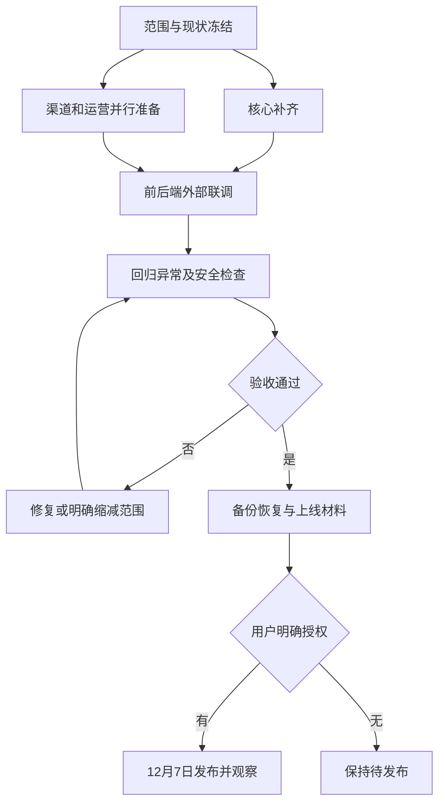

# 上线开发任务清单

截至2026-11-08；基于当前main源码。详细证据见主文档附录。

## 第一部分：上线必需清单与增量
| 编号 / 模块 | 当前情况 → 上线前增量 | 优先级 / 必需 |
| --- | --- | --- |
| L01 登录与账号 | 已有三登录；补显式绑定、冲突引导、目标地区验收。关联问题Q03。 | P0 / 是 |
| L02 首次权益 | 已有100积分逻辑；核验绑定不重发、展示、规则和异常客服。 | P0 / 是 |
| L03 编辑式生成 | 已有完整主链；保留，验证真实交付、积分与恢复。 | P0 / 是 |
| L04 快速生成 | 缺后台编排；复用歌词和任务接口，补父任务、自动选词授权、恢复。 | P0 / 是 |
| L05 支付积分 | 复用PayPal与ledger；补Q01/Q02/Q04/Q05，不按旧文档从零建支付。 | P0 / 是 |
| L06 分享与发布 | 分享已有；核验门禁；新增公开发布、审核、主页、列表及下架。 | P0 / 是 |
| L07 人工发行 | 新增申请、补件、受理人、邮件记录、分渠道状态和通知。 | P0 / 是 |
| L08 海外运营 | 英文已有；统一地区、手机默认、邮件、客服与销售声明。 | P0 / 是 |
| L09 体验收尾 | 空标签、提示摘要、完成通知、收藏关注按优先级推进。 | P1 / 条件 |
| L10 高级工作室 | 个人声音、完整推荐、订阅、自动发行放后续。 | P2/P3 / 否 |
前置依赖：账号统一 → 资产与积分验收；费用规则 → 快速交付和退款；发布实体 → 社区列表；合作渠道与资料模板 → 发行。外部商户与短信从第一天并行办理。

## 五阶段实施计划与依赖

估算前提：复用现有模块，至少能够覆盖身份/资金、创作、发布/发行和QA运营四类工作流。这里是工作流而非承诺团队人数；人力未确认，不承诺所有新增项一定按时完成。
关键路径：外部商户与短信资格、账号资产归属、资金异常、快速交付。社区和人工发行可按接口约定并行开发，但必须真实连调；若人力不足，会议明确缩减，不默认获得延期授权。

## 阶段交付与可执行任务清单
| 阶段 / 任务 | 前置与交付成果 | 通过标准 |
| --- | --- | --- |
| 阶段1：现状冻结 | A01 读线上JAR/Flyway、渠道资格；A02 确认账户/积分/发行规则 | 有证据清单和负责人，未知项有取得回执日期 |
| 阶段2：核心补齐 | B01 L01绑定；B02 L04编排；B03 L05资金；B04 L06发布；B05 L07人工发行 | 接口、页面、数据关系和异常出口一致，不重做已完成编辑器 |
| 阶段3：联调 | C01 三登录资产；C02 制作付费；C03 发布发行；渠道与运营并行 | 以新用户跑通，任务、流水和回执相符 |
| 阶段4：验证修复 | D01 按验收矩阵；D02 Q01-Q08关闭或明确阻断 | 核心缺陷关闭，技术和业务责任人签字 |
| 阶段5：发布准备 | E01 测试构建、备份恢复；E02 Go/No-Go与授权 | 可回滚且恢复演练通过，正式渠道与服务可用 |
可并行：身份与支付、创作、社区/发行、渠道准备；共同字段先约定creator、work、revision、asset、quote、order、application。管理员操作需要独立权限，不能伪装成作品所有者。
| 任务包 | 建议责任角色 | 工期说明 |
| --- | --- | --- |
| B01/B03 | 身份与资金开发 + 商户负责人 | 账号服务商和支付真实验收会影响时长 |
| B02 | 创作后端 + 前端 | 需要跨阶段失败恢复，不只是按钮 |
| B04/B05 | 业务开发 + 内容/发行运营 | 新表与权限、流程较多，优先人工闭环 |
| C/D/E | QA + 业务负责人 + 运维 | 验收与恢复不可挤到最后一天 |
负责人姓名和人日须会上填写；本版不虚构团队编制。详细任务可在随附《上线开发任务清单.md》中逐项勾选。

## 上线验收矩阵：业务与接口
| 类别 | 必测场景 | 通过标准 |
| --- | --- | --- |
| 核心功能 | 两条创作、编辑保存、播放下载、发布分享 | 新用户自行完成；结果对应所选版本，无丢失或误覆盖 |
| 登录与权限 | 三登录、绑定、跨设备、跨用户作品和订单访问 | 同账号资产一致，未授权不得读写别人的私人资源 |
| 首次权益 | 首次登录、重复回调、绑定新方式 | 每个creator仅一次100积分；页面与流水相符 |
| 前后端契约 | 报价、preflight、生成、退款、发布与发行字段 | 必填、状态和错误码一致；异常响应不伪装成功 |
| 积分与支付 | 成功、中断、延迟、重复、退款与争议 | 实际支付结果入账一次，消费与补偿可定位，不凭返回页 |
| 制作异常 | 供应商拒绝、未知、归档失败、迟到结果 | 原任务核对不重复付费；未交付补偿符合公开规则 |
| 运营与发行 | 审核、补件、发邮件、渠道拒绝/上线 | 有申请号、负责人、发送和回执记录；用户能查状态 |
| 公开访问 | 无登录无邀请码、撤销、过期、下架 | 公开页正常试听，失效资源受控，私人内容不泄露 |
本轮已执行：前端32文件227项通过；公开能力和登录GET被邀请码拦截。后端测试未重新运行、真实支付短信模型未调用，不能用历史报告替代本轮验收。
现有H2测试配置可作为隔离自动化依据，但执行前需确认配置导入和数据源，禁止任何清库夹具或模拟支付写入生产主库。

## 上线验收矩阵：数据、运行与安全
| 类别 | 必测范围 | 通过标准 / 边界 |
| --- | --- | --- |
| 数据库 | 实际迁移版本校验、关系、幂等约束、资金一致性 | 生产版本与JAR兼容；无孤立引用；按真实订单核对；不自动跑未上线迁移 |
| 兼容性 | 目标地区手机浏览器、电脑、英文、邮箱短信 | 关键流程可完成，验证码和通知可达；具体设备清单待会议确认 |
| 性能 | 并发登录、制作品控、积分锁、音频访问 | 先确定目标并发/延迟/错误率；压测达到约定且账目无错。现有max-in-flight不是容量承诺 |
| 安全 | CSRF、归属、签名、金额币种、上传、后台权限 | 越权和伪造被拒绝；凭证不进前端和报告；异常请求不泄露内容 |
| 备份恢复 | 程序、配置、迁移关联与媒体恢复 | 可在批准范围恢复并核对作品/资金；RPO/RTO先定再测，不虚构数值 |
| 生产部署 | main整合测试构建、备份、current与健康 | 按AGENTS流程；明确授权后才发布；失败不继续，保留回滚与观察记录 |
部署规程：git fetch --all，检查工作区后在main整合同事分支，npm test、mvn verify，构建JAR，备份并确认回滚，最后授权切换current与重启。本文没有执行任何发布步骤。
主库规程：使用已确认生产库的SSH隧道与日常入口，不自行切到历史测试库；不在主库执行夹具、模拟支付和未上线迁移。授权的隔离自动化不等于另建日常业务库。

## 风险、决策与范围控制
| 风险 | 应对与决策 |
| --- | --- |
| 新增范围与29天期限 | 首发缺绑定、快速编排、社区和发行；按依赖安排，不大规模重构。若资源不足，会上明确调整对外承诺 |
| 真实销售条件 | Q01/Q02/Q04/Q05及商户资格未验收不开放销售；不把代码或Sandbox当Live回执 |
| 生产不确定性 | 获取实际版本、迁移、服务和渠道回执；本轮403与私钥缺失不能替代完整检查 |
| 生成费用与质量 | 免费5次、封面5、局部8均需成本验证；候选数量与完整性先定义再销售 |
| 发行范围与权利 | 确认合作渠道、音频/封面标准、授权、处理周期和退款规则；不承诺全渠道成功 |
| 运营承接 | 设置审核、补件、资金异常、举报负责人及处理时限；没有运营承接就不是完整闭环 |
> 会上需确认：首发国家与手机区号；显式绑定规则；快速整笔交付；预扣退款还是冻结结算；免费与付费候选价；plpay具体渠道；微信开通；社区最小范围；发行合作方；团队与验收负责人。
可复用成果：登录与100积分、编辑器、preflight、任务执行/恢复、多候选归档、媒体和快照分享、PayPal与流水。优先把已有路径做成可销售、可支持的服务，再增加公开社区和人工发行的最小闭环。

## 执行登记

| 任务 | 负责人 | 截止日期 | 状态 | 验收证据 |
|---|---|---|---|---|
| A01线上现状 | 待指派 | 待确认 | 待开始 | 待补充 |
| A02规则冻结 | 待指派 | 待确认 | 待开始 | 待补充 |
| B01账号绑定 | 待指派 | 待确认 | 待开始 | 待补充 |
| B02快速流程 | 待指派 | 待确认 | 待开始 | 待补充 |
| B03支付异常 | 待指派 | 待确认 | 待开始 | 待补充 |
| B04发布社区 | 待指派 | 待确认 | 待开始 | 待补充 |
| B05人工发行 | 待指派 | 待确认 | 待开始 | 待补充 |
| C01账号联调 | 待指派 | 待确认 | 待开始 | 待补充 |
| C02制作资金 | 待指派 | 待确认 | 待开始 | 待补充 |
| C03发布发行 | 待指派 | 待确认 | 待开始 | 待补充 |
| D01验收矩阵 | 待指派 | 待确认 | 待开始 | 待补充 |
| D02问题关闭 | 待指派 | 待确认 | 待开始 | 待补充 |
| E01备份恢复 | 待指派 | 待确认 | 待开始 | 待补充 |
| E02授权发布 | 待指派 | 待确认 | 待开始 | 待补充 |
