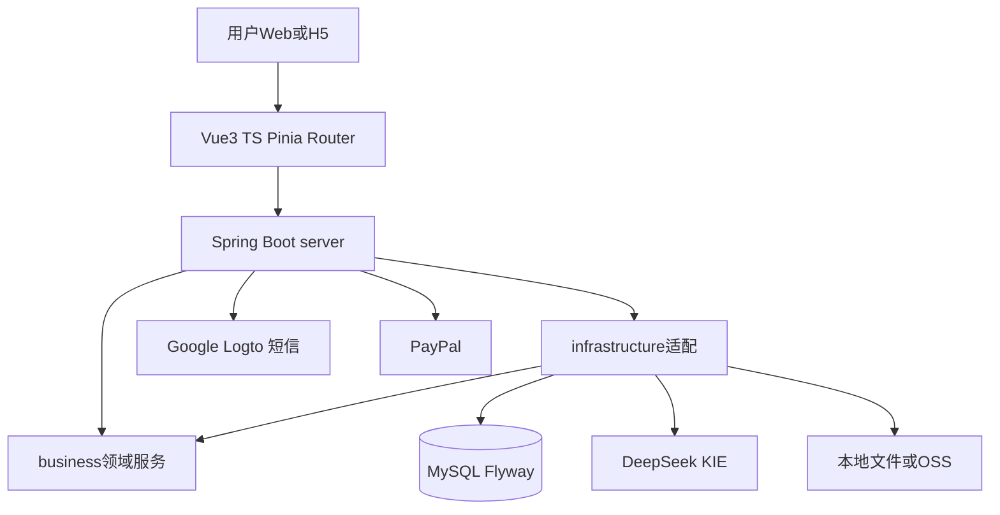
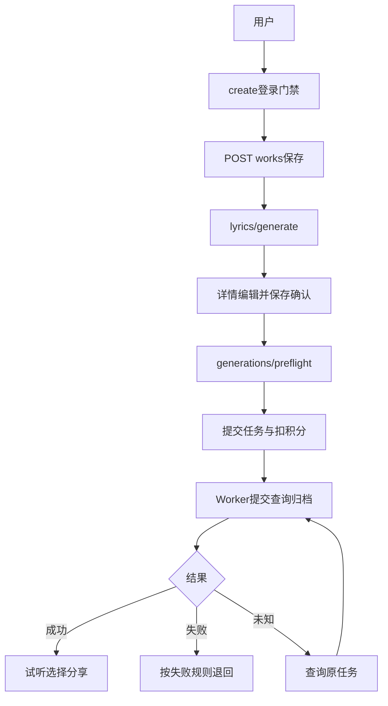
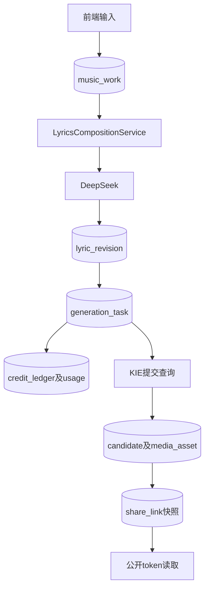
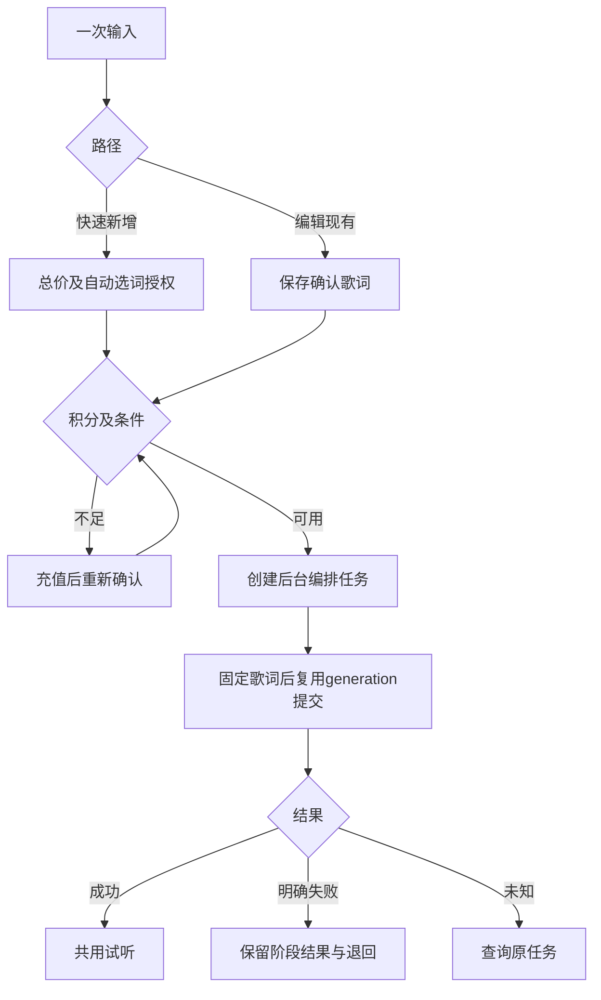
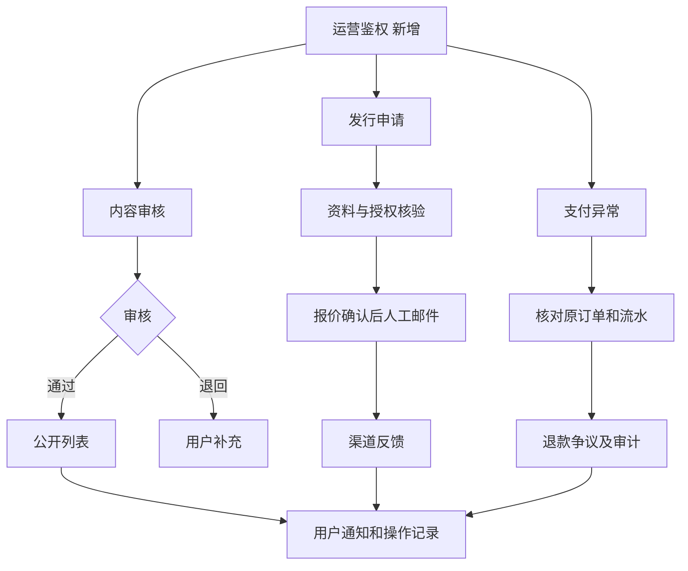
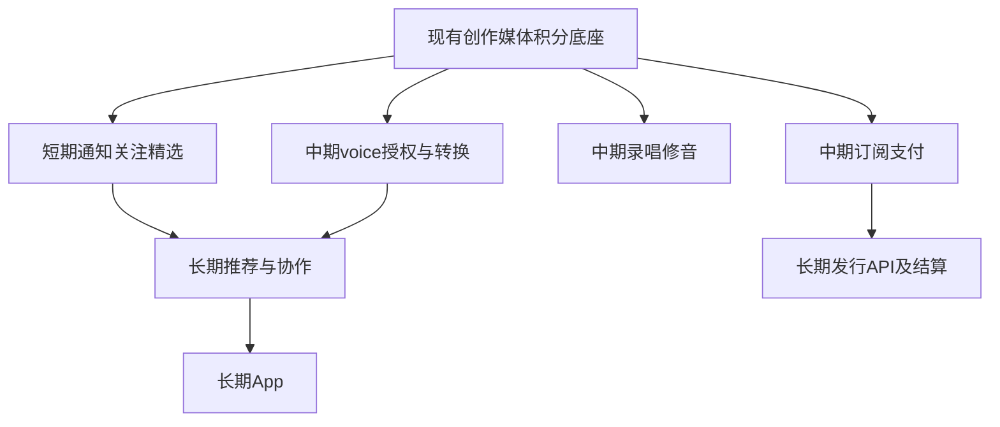
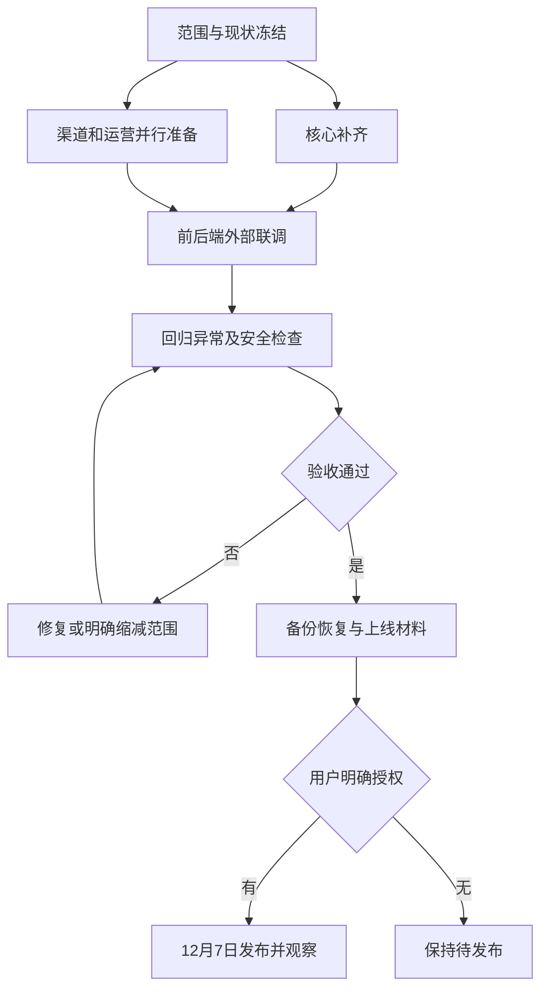

# 项目业务流程梳理及2026年12月7日上线实施方案

版本：V2.0 源码审查版，2026-11-08。

## 封面

> 人人都是歌手
> 项目业务流程梳理及2026年12月7日上线实施方案

基于现有代码的审查版 · V2.0 · 2026年11月8日

面向海外ToC用户。重点复用已实现的登录、歌词版本、歌曲任务、积分、PayPal和分享，补齐快速制作、账号绑定、公开社区与人工发行闭环。

四个核心部分：首发必需业务；未来拓展；已有功能优化；当前问题与证据。附功能盘点、数据库关系、7类流程图、五阶段计划及验收清单。

> 证据边界：本地main源码索引与关键链路追踪；前端227项测试通过；线上公开能力及登录状态GET均返回403邀请码门禁。服务器私钥缺失，未确认实际JAR、生产迁移、支付开关或真实账目。没有修改业务代码、配置和数据库，也没有部署。

原讨论稿描述的是目标流程，本版以当前代码重新校准，不能据旧文档直接认定某功能已上线。未来与新增功能均有明确标记。

## 目录

- 第3页：项目概述、检查方法与结论
- 第4页：当前架构与第三方依赖
- 第5页：数据库结构与关键关联
- 第6页：功能盘点一：身份、创作、任务
- 第7页：功能盘点二：媒体、收费与运营
- 第8页：功能盘点三：辅助与基础业务
- 第9页：现有核心用户流程与真实接口
- 第10页：关键数据流：从想法到分享
- 第11页：第一部分：上线必需清单与增量
- 第12页：首发新增：快速生成与统一音乐方向
- 第13页：首发付费口径与现有实现差异
- 第14页：管理后台目标与人工发行闭环
- 第15页：第二部分：未来拓展路线
- 第16页：第三部分：已有功能的针对性优化
- 第17页：第四部分：当前问题与代码证据（一）
- 第18页：第四部分：当前问题与代码证据（二）
- 第19页：五阶段实施计划与依赖
- 第20页：阶段交付与可执行任务清单
- 第21页：上线验收矩阵：业务与接口
- 第22页：上线验收矩阵：数据、运行与安全
- 第23页：风险、决策与范围控制
- 第24页：证据附录：代码位置（一）
- 第25页：证据附录：代码位置（二）

## 项目概述、检查方法与结论

截至2026年11月8日，距12月7日29天。检查分支main，提交18ab6b9342a8。开始时工作区干净；本轮只新增方案输出和生成脚本。

对404份源文件与迁移建立索引，包含Java、Vue、TS、SQL、YAML/XML；逐条追踪登录、草稿、歌词、谱曲、媒体、分享和支付关键链路。全量索引不等于逐行证明所有代码无缺陷。

| 证据层级 | 本轮得到什么 | 不能推导什么 |
| --- | --- | --- |
| 代码静态 | 页面、调用、接口、SQL与事务路径可定位 | 不等于真实模型或生产销售通过 |
| 实际测试 | npm test：32文件、227测试通过 | 不代表真实短信、商户或数据库验证 |
| 线上GET | 两条公开接口403 INVITE_REQUIRED | 不代表服务宕机，也不能确认功能开关 |
| 无法核验 | 私钥缺失；未连接服务器和生产库 | 不猜测运行JAR或生产Flyway版本 |

> 主结论：核心编辑式创作不是重做项；快速创作缺后台编排；标签默认来源已找到；积分是直接扣减而非冻结结算；支付退款/争议事件缺口可定位；社区、发行及自主多身份绑定未形成当前仓库闭环。

## 当前架构与第三方依赖

Maven四模块：common/business/infrastructure/server；Java17、Boot4.1.2、MyBatis4。Vue3.5、Router5、Pinia4，含Capacitor适配但不能据此认定App上线。公共能力包括HTTP响应校验、CSRF、creator会话、播放器、恢复副本、配额、任务租约与参数快照。

部署按仓库脚本为JAR + 静态前端，服务器current版本链接，反向代理与systemd见部署记录。当前执行版待服务器核对。日常入口限制主库隧道与关闭本地调度，分析期间没有启动运行时。[E01/E21/E22/E23]

## 数据库结构与关键关联

| 领域 | 迁移中实际结构 | 核心关系 |
| --- | --- | --- |
| 身份 | creator / creator_session / google、oidc、authing identity | 身份和会话归creator；OIDC按issuer+subject哈希识别 |
| 作品与歌词 | music_work / lyric_revision / lyrics_composition_request | work.owner归creator；歌词记录work版本与请求 |
| 制作执行 | generation_task / generation_attempt / worker锁 | 任务固定歌词和参数；尝试、租约和外部任务关联 |
| 媒体 | media_asset / selection / audio_source / timeline / cover | 任务产生音频候选；作品选定资产；时间轴按资产缓存 |
| 分享 | share_link | 绑定音频、歌词内容和封面快照；token只存哈希 |
| 额度与积分 | model_usage_reservation / credit_ledger / credit_lock | 工作与请求键关联扣减；流水主键限制重复记账 |
| 支付 | payment_order / payment_risk_event | 订单固定金额币种积分，关联creator和外部支付 |
| V23新增 | lyric_creative_plan / generation_audio_candidates / music_listening_feedback | 创意计划归歌词；候选归任务；反馈归音频 |

本地迁移文件V1至V23；不能据此宣称生产已执行V23。FK与唯一约束可从SQL确认，生产实际行数、校验值、历史数据和孤立记录尚未查验。[E19/E25/E26]

> 未在当前路由、Controller、业务实体和迁移索引找到完整artist/publication/community/release申请领域。music_listening_feedback是单资产反馈结构，不等于社区关注、评论和公开发布。

## 功能盘点一：身份、创作、任务

| 模块与状态 | 前端 / 后端 / 数据 | 结论与下一步 |
| --- | --- | --- |
| Google、邮箱、手机：部分完成 | LoginModal、Google/NativeAuthController；三类identity表 [E03/E04] | 已有真实调用路径；实际服务资格与目标地区待验证，不能重新安排从零登录 |
| 多身份自主绑定：未实现 | LogtoIdentityService有冲突拒绝，未见独立绑定页与业务接口 [E04] | 补已登录绑定与冲突提示；不能把signIn直接当完整绑定 |
| 首次100积分：已完成（代码） | FirstLoginCredits + Welcome接口/弹窗 + credit_ledger [E05] | 按creator和业务引用幂等；跨身份同人仍依赖绑定 |
| 草稿及恢复：已完成（代码） | DraftStudio → WorkController → WorkService → music_work | 版本冲突、本机副本与归属校验已有，需海外端验收 |
| 歌词版本：已完成（代码） | LyricsPanel → lyrics保存/确认 → lyric_revision [E09] | 显式保存和未保存阻止制作已存在，不重做 |
| 编辑后谱曲：已完成（代码） | detail.generate → preflight/submit → GenerationService [E10/E11] | 供应商、真实扣费和异常仍待运行验证 |
| 快速歌曲：未实现完整链路 | DraftStudio当前只写词后进入详情 [E08] | 缺自动选词、后台串联和整笔交付状态 |

状态说明：“已完成”限定页面、接口与数据的核心代码链路基本完整；所有生产能力另有待验证列，不代表公网已验收。未将文档中的历史测试数字当本轮结果。

## 功能盘点二：媒体、收费与运营

| 模块与状态 | 前端 / 后端 / 数据 | 结论与下一步 |
| --- | --- | --- |
| 多候选、试听、下载：部分完成 | 媒体列表/选择、Worker候选保存、V23 [E12/E19] | 多候选已具代码；真实数量、部分成功交付待定义 |
| 封面与同步歌词：已完成（代码） | CoverEditor、SyncedLyrics；cover/timeline接口表 | 保留现有读取缓存；真实图片加工效果待验证 |
| 局部重唱：部分完成 | SectionEditor、SectionEditingController、section_edit | 保留流程；8积分仅候选价，当前走MUSIC额度，不可假定已独立收费 |
| 积分消费：部分完成 | credits余额 + JdbcUsageBudget.debit + ledger [E13/E14] | 直接扣减并按部分失败退回，缺冻结及到期批次 |
| PayPal充值：部分完成 | RechargePage → PayPal orders/capture → payment_order [E15/E16] | 完成事件已核验入账；取消过期、退款争议缺口需补 |
| 微信充值：未实现闭环 | 当前有PayPal直连，Airwallex实现固定Sandbox | 现有旧网关不能当微信生产能力；须确认商户 |
| 公开分享：已完成（代码） | SharePanel/PublicGiftPage → sharing → share_link [E18] | 当前源码可追踪；公网实际分享免门禁仍待测 |
| 社区、歌手主页：未实现 | 首页静态试听不是用户内容社区；无完整发布实体 | 新增最小发布审核、主页与发现列表 |
| 发行及运营后台：未实现 | 未检出申请表单、审核角色、邮件投递与状态表 | 人工流程也需系统受理、补件与结果回写 |

## 功能盘点三：辅助与基础业务

| 模块与状态 | 已有代码依据 | 上线处理 |
| --- | --- | --- |
| 想法改写：已完成（代码） | DraftStudio与InspirationController /rewrite → InspirationRewriteService | 已有AI辅助，复用预览采用，不再列为从零新增；真实效果待验 |
| 音乐偏好与精简：已完成（代码） | MusicSettingsPanel → MusicSettingsController、MusicBriefController → work/generation偏好快照 | 保留配方和参数编译；按O01变更默认，不删除既有自选能力 |
| 邀请码门禁：已完成（代码） | InviteGateFilter/Service及前端BetaAccessGate；线上403已证实 | 确定正式开放范围，不将内测保护本身视为故障 |
| 邀请奖励：部分完成 | ReferralController/JdbcReferralRewards + referral_pending + FirstLoginCredits回调 | 已有奖励基础，独立于内测邀请码；防滥用和规则待验，不承诺本次新增复杂奖励 |
| 身份找回与游客作品认领：已完成（代码） | IdentityService与GuestDraftAssociation；creator会话、找回哈希和所有权 | 多身份绑定与游客认领不同；首发保留并验收跨设备 |
| 用量及供应商恢复：已完成（代码） | UsageBudget、ResilientMusicProvider、GenerationDispatcher | 额度、熔断/恢复与执行已有基础；默认参数不证明实际并发能力 |
| 存储与CDN：待验证（运行） | StorageConfiguration、MediaCdnSigner、本地/OSS适配与音频Range响应 | 按实际启用配置验收；不能把适配器存在写成OSS/CDN已启用 |
| 退款争议审计：部分完成 | PaymentRiskJournal支持已验签事件留档；主webhook未接通非完成事件 | 复用审计表与幂等，不从零建日志；仍需Q01资金处置和运营队列 |

辅助模块位置均可在随附Controller与源码索引定位。用户资料、运营声明与真实渠道能力仍需运行验收，代码级完整不等于生产资格。

## 现有核心用户流程与真实接口

调用关系：前端当前编辑链路可定位[E08/E09]；preflight不落库不占额，正式submit仍重新校验[E10/E11]。当前不是一键从想法完成歌曲，不能在方案中画成已实现。

异常：草稿expectedVersion冲突不覆盖；歌词请求key查结果；歌曲超时转待核对；失败与归档重试有区分；无外部编号结束等待不等于退款。[E11/E12]

## 关键数据流：从想法到分享

| 不变量 | 当前实现与复用价值 |
| --- | --- |
| 归属 | owner来自服务端creator，作品读取先校验归属；跨用户访问应拒绝 |
| 版本 | 任务固定已确认歌词与音乐参数；作品更新不会自动改已交付音频 |
| 幂等 | 草稿键、生成请求键、积分引用和支付订单共同防重复 |
| 隐私 | 分享输出白名单快照，不直接公开故事与私人编辑接口 |

数据关系以迁移与服务追踪为据，未核验生产数据库实况。用户手动创建的业务模板与未来发行元数据不得反写旧音频快照。

## 第一部分：上线必需清单与增量

| 编号 / 模块 | 当前情况 → 上线前增量 | 优先级 / 必需 |
| --- | --- | --- |
| L01 登录与账号 | 已有三登录；补显式绑定、冲突引导、目标地区验收。关联问题Q03。 | P0 / 是 |
| L02 首次权益 | 已有100积分逻辑；核验绑定不重发、展示、规则和异常客服。 | P0 / 是 |
| L03 编辑式生成 | 已有完整主链；保留，验证真实交付、积分与恢复。 | P0 / 是 |
| L04 快速生成 | 缺后台编排；复用歌词和任务接口，补父任务、自动选词授权、恢复。 | P0 / 是 |
| L05 支付积分 | 复用PayPal与ledger；补Q01/Q02/Q04/Q05，不按旧文档从零建支付。 | P0 / 是 |
| L06 分享与发布 | 分享已有；核验门禁；新增公开发布、审核、主页、列表及下架。 | P0 / 是 |
| L07 人工发行 | 新增申请、补件、受理人、邮件记录、分渠道状态和通知。 | P0 / 是 |
| L08 海外运营 | 英文已有；统一地区、手机默认、邮件、客服与销售声明。 | P0 / 是 |
| L09 体验收尾 | 空标签、提示摘要、完成通知、收藏关注按优先级推进。 | P1 / 条件 |
| L10 高级工作室 | 个人声音、完整推荐、订阅、自动发行放后续。 | P2/P3 / 否 |

前置依赖：账号统一 → 资产与积分验收；费用规则 → 快速交付和退款；发布实体 → 社区列表；合作渠道与资料模板 → 发行。外部商户与短信从第一天并行办理。

## 首发新增：快速生成与统一音乐方向

新增父级创作流程至少记录stage、lyricsRevision、generationTask、路径和quote引用，断页后不依赖浏览器继续。可复用V23创意计划与音频候选，但这两个表不等于已有父任务编排。

用户要求标签不默认选择属于目标变更：E06默认风格与E07旧偏好转换均要适配；字段可为空不等于删除模型必要描述，最终由明确输入和选择生成统一要求。

## 首发付费口径与现有实现差异

| 事项 | 现有代码 | 上线建议 |
| --- | --- | --- |
| 套餐与基础消耗 | PaymentCatalog默认美元100/300/700，4.99/12.99/24.99；music-cost15 [E17] | 保留候选口径，生产配置与税费待商户核验 |
| 积分模型 | CREDIT/DEBIT/REFUND，提交时直接扣；无冻结字段 [E13/E25] | 会议决定保留预扣退回或增加冻结；文案必须如实 |
| 额外收费 | 未确认歌词2、封面5、局部8的独立计价链路 | 均为候选新规则，不把价格表当已实现 |
| 免费额度 | 使用UsageBudget按种类限制；不是已落地每日5次后2积分阶梯 | 先核算免费成本，定稿后再开发 |
| 来源与到期 | 当前余额为SUM流水，未见购买/赠送批次到期模型 | 首发不承诺未实现的自动过期，新增要有来源追踪 |
| 快速失败 | 现有只对歌曲任务扣费退款，不存在整链服务结算 | 定义15积分整笔交付：未交付歌曲不事后拆收歌词费 |

> 先复用预扣+退回也可以形成首发业务，但必须明确这是与此前“冻结后结算”不同的实现选择。若坚持冻结，要增加账本状态及迁移、前后端余额展示与异常核对，不仅改提示。

100积分按15可进行6次基础制作剩10。按三套餐折算15积分约$0.75/$0.65/$0.54，不是最终满意成品固定价。

收费前展示交付数量与范围；正常不喜欢与技术未交付区分。充值退款、争议与制作退积分分开；重复回调与迟到结果均不得重复记账。

## 管理后台目标与人工发行闭环

当前没有完整后台：本图均为首发明确新增目标，复用现有支付服务和公开作品资产，不把系统管理接口直接向运营开放。最低角色区分作品本人、内容审核、发行经办和资金处理。

发行申请需要确定成品版本、署名与AI参与、声音/素材授权、目标渠道和日期；资料缺项补件，受理后留邮件与回执。已发邮件不等于已上线，按渠道记录成功、拒绝、处理中与下架。

新增数据建议publication/artist_profile/release_application/release_channel_result/operator_audit仅为设计名，不是现有表。报价后支付时复用支付基础设施，不能绕过真实记账。

## 第二部分：未来拓展路线

| 方向 / 阶段 | 业务价值与关联 | 所需新增 |
| --- | --- | --- |
| 通知与精选 / 短期 | 复用任务状态、公开作品和播放器，提高回访 | 通知投递、主题和运营配置 |
| 个人声音 / 中期 | 复用media与provider端口，打造个人演唱 | 授权、声音模型、转换质量与删除流程 |
| 录唱 / 中期 | 复用音频与时间轴，提升参与感 | 浏览器录音、修音混音与新任务类型 |
| 订阅 / 中期 | 复用payment与ledger，支持持续创作 | 订阅生命周期、到期规则与渠道事件 |
| 自动发行 / 长期 | 复用人工申请状态，减少人工成本 | 合作方接口、回传及失败补偿 |
| 分账与App / 长期 | 复用身份和媒体，但独立验证商业可行性 | 现金收益账本、分账合约、原生登录支付 |

无需立即拆微服务。分账、实时录音、大规模推荐会显著增加架构与合规范围，另评估；不挤占首发P0。

## 第三部分：已有功能的针对性优化

| 编号 / 模块 | 现有与不足 | 复用方案及价值 / 优先级 |
| --- | --- | --- |
| O01 默认风格 | E06始终温暖民谣，E07再推导folk/guitar；用户未主动选择 | 调整默认与迁移兼容，允许空选择；文本要求与标签统一，冲突确认。P1 |
| O02 登录时机 | E02进入/create就弹登录；与先写想法再登录的目标不同 | 保留守卫，按业务决定是否仅制作前拦截并恢复输入。P1 |
| O03 海外默认 | E24手机号国家默认CN | 按目标市场或用户明确选择设置，不擅自猜地区；降低填错率。P1 |
| O04 资金吞吐 | E14全局credit_lock；所有账户记账串行 | 保持幂等，评估账户级锁与余额投影；先压测再改。P2 |
| O05 多候选交付 | E12逐个下载，全候选完毕后标成功；任一失败走归档失败 | 定义最低交付数量，展示部分状态，复用已保存候选避免重复下载。P1 |
| O06 歌词长度 | 手动可保存12000字，AI写词与供应商限制需另外校验 | 利用已有preflight展示平台/模型实际限制；不在最终提交才报错。P1 |
| O07 历史列表 | 订单列表最近50，歌词历史最多100；暂缺跨历史检索 | 在现有查询增加分页和订单筛选，不重做支付。P2 |

本表只包含已有功能可改善之处；阻断销售的退款事件和订单滞留归Q问题与L05必需项，不在优化表重复登记。快速生成、社区与发行属于新增上线范围，不伪装成现有功能优化。

## 第四部分：当前问题与代码证据（一）

| 编号 / 程度 | 事实与位置 | 影响与处理 |
| --- | --- | --- |
| Q01 / 高 | E16 PayPalPaymentService.webhook仅处理CAPTURE.COMPLETED；其余已验签事件返回503 | 退款/争议不能自动闭环。补事件去重、人工队列和积分关联；真实事件待验证。归L05 |
| Q02 / 高 | E15 create先插CREATING，调用外部create后回写；存在CREATING/PENDING即拒绝新建 | 外部建单响应丢失或用户放弃时可能阻塞再次充值。补按引用核对、取消/过期策略；故障注入待测。归L05 |
| Q03 / 高 | E04对已有OIDC新subject返回ACCOUNT_CONFLICT；路由/Controller未见自主绑定完整入口 | 三登录不等于同账号多方式；补已登录验证绑定与提示，不自动合并资产。归L01 |
| Q04 / 高 | E13/E25直接DEBIT；CreditsController只返回balance、enabled、musicCost | 与冻结结算目标不一致。会上选择预扣方案或补冻结模型，不能宣传已冻结。归L05 |
| Q05 / 高 | GenerationService.closeChecking调用mapper.close；归档重试耗尽走archiveFailed，不经过failed的退款路径 | 结束追踪及最终归档失败不保证退款。不是重复扣款证据；补未交付人工判定与补偿。归L05 |

> 以上为可定位实现差异或缺失，不宣称线上已经发生资金损失、账号泄露或失败事件。高优先级是因为影响正式商业闭环。所有修复需在授权范围验证，不在主库构造模拟支付。

## 第四部分：当前问题与代码证据（二）

| 编号 / 程度 | 事实与依据 | 影响与处理 |
| --- | --- | --- |
| Q06 / 高 | 本轮线上GET system/info与auth/native/status均403 INVITE_REQUIRED；证据S01 | 公开首发用户被门禁拦截；明确开放路径并验收。不据此认定服务宕机。归L08 |
| Q07 / 高 | E08写词完成后跳详情；未找到持久化快速父流程与双路径入口 | 不能实现离站仍自动成歌；补L04编排和恢复，不仅在前端连调两次 |
| Q08 / 高 | 路由、Controller和迁移索引无完整社区发布/发行申请及后台 | 用户要求首发但尚无实现依据；新增L06/L07，划清人工边界 |
| Q09 / 中 | E19本地V23；生产数据库未连接，历史文档版本互有覆盖 | 不能假定现有运行库支持新候选；上线前读实际Flyway和JAR清单 |
| Q10 / 中 | E20仍有音频导入API，文档写移除导入入口 | 不是直接证明漏洞；确认产品是否仅隐藏入口，校验权限与容量，避免意外支持承诺 |
| Q11 / 中 | 脚本E23引用的部署私钥不存在；本机无.secrets主库材料 | 本轮无法SSH与SQL核验；由运维提供可用只读路径或脱敏回执，不猜测生产状态 |

未发现有足够证据可定为“已发生严重数据泄露”的项。没有证据不等于完成全面安全审计；技术方案仍需权限、并发、供应商和灾备专项。

表中业务缺口已分别映射L任务；只在问题清单保留一个编号，在其他章节以编号引用，避免重复排期。

## 五阶段实施计划与依赖

估算前提：复用现有模块，至少能够覆盖身份/资金、创作、发布/发行和QA运营四类工作流。这里是工作流而非承诺团队人数；人力未确认，不承诺所有新增项一定按时完成。

关键路径：外部商户与短信资格、账号资产归属、资金异常、快速交付。社区和人工发行可按接口约定并行开发，但必须真实连调；若人力不足，会议明确缩减，不默认获得延期授权。

## 阶段交付与可执行任务清单

| 阶段 / 任务 | 前置与交付成果 | 通过标准 |
| --- | --- | --- |
| 阶段1：现状冻结 | A01 读线上JAR/Flyway、渠道资格；A02 确认账户/积分/发行规则 | 有证据清单和负责人，未知项有取得回执日期 |
| 阶段2：核心补齐 | B01 L01绑定；B02 L04编排；B03 L05资金；B04 L06发布；B05 L07人工发行 | 接口、页面、数据关系和异常出口一致，不重做已完成编辑器 |
| 阶段3：联调 | C01 三登录资产；C02 制作付费；C03 发布发行；渠道与运营并行 | 以新用户跑通，任务、流水和回执相符 |
| 阶段4：验证修复 | D01 按验收矩阵；D02 Q01-Q08关闭或明确阻断 | 核心缺陷关闭，技术和业务责任人签字 |
| 阶段5：发布准备 | E01 测试构建、备份恢复；E02 Go/No-Go与授权 | 可回滚且恢复演练通过，正式渠道与服务可用 |

可并行：身份与支付、创作、社区/发行、渠道准备；共同字段先约定creator、work、revision、asset、quote、order、application。管理员操作需要独立权限，不能伪装成作品所有者。

| 任务包 | 建议责任角色 | 工期说明 |
| --- | --- | --- |
| B01/B03 | 身份与资金开发 + 商户负责人 | 账号服务商和支付真实验收会影响时长 |
| B02 | 创作后端 + 前端 | 需要跨阶段失败恢复，不只是按钮 |
| B04/B05 | 业务开发 + 内容/发行运营 | 新表与权限、流程较多，优先人工闭环 |
| C/D/E | QA + 业务负责人 + 运维 | 验收与恢复不可挤到最后一天 |

负责人姓名和人日须会上填写；本版不虚构团队编制。详细任务可在随附《上线开发任务清单.md》中逐项勾选。

## 上线验收矩阵：业务与接口

| 类别 | 必测场景 | 通过标准 |
| --- | --- | --- |
| 核心功能 | 两条创作、编辑保存、播放下载、发布分享 | 新用户自行完成；结果对应所选版本，无丢失或误覆盖 |
| 登录与权限 | 三登录、绑定、跨设备、跨用户作品和订单访问 | 同账号资产一致，未授权不得读写别人的私人资源 |
| 首次权益 | 首次登录、重复回调、绑定新方式 | 每个creator仅一次100积分；页面与流水相符 |
| 前后端契约 | 报价、preflight、生成、退款、发布与发行字段 | 必填、状态和错误码一致；异常响应不伪装成功 |
| 积分与支付 | 成功、中断、延迟、重复、退款与争议 | 实际支付结果入账一次，消费与补偿可定位，不凭返回页 |
| 制作异常 | 供应商拒绝、未知、归档失败、迟到结果 | 原任务核对不重复付费；未交付补偿符合公开规则 |
| 运营与发行 | 审核、补件、发邮件、渠道拒绝/上线 | 有申请号、负责人、发送和回执记录；用户能查状态 |
| 公开访问 | 无登录无邀请码、撤销、过期、下架 | 公开页正常试听，失效资源受控，私人内容不泄露 |

本轮已执行：前端32文件227项通过；公开能力和登录GET被邀请码拦截。后端测试未重新运行、真实支付短信模型未调用，不能用历史报告替代本轮验收。

现有H2测试配置可作为隔离自动化依据，但执行前需确认配置导入和数据源，禁止任何清库夹具或模拟支付写入生产主库。

## 上线验收矩阵：数据、运行与安全

| 类别 | 必测范围 | 通过标准 / 边界 |
| --- | --- | --- |
| 数据库 | 实际迁移版本校验、关系、幂等约束、资金一致性 | 生产版本与JAR兼容；无孤立引用；按真实订单核对；不自动跑未上线迁移 |
| 兼容性 | 目标地区手机浏览器、电脑、英文、邮箱短信 | 关键流程可完成，验证码和通知可达；具体设备清单待会议确认 |
| 性能 | 并发登录、制作品控、积分锁、音频访问 | 先确定目标并发/延迟/错误率；压测达到约定且账目无错。现有max-in-flight不是容量承诺 |
| 安全 | CSRF、归属、签名、金额币种、上传、后台权限 | 越权和伪造被拒绝；凭证不进前端和报告；异常请求不泄露内容 |
| 备份恢复 | 程序、配置、迁移关联与媒体恢复 | 可在批准范围恢复并核对作品/资金；RPO/RTO先定再测，不虚构数值 |
| 生产部署 | main整合测试构建、备份、current与健康 | 按AGENTS流程；明确授权后才发布；失败不继续，保留回滚与观察记录 |

部署规程：git fetch --all，检查工作区后在main整合同事分支，npm test、mvn verify，构建JAR，备份并确认回滚，最后授权切换current与重启。本文没有执行任何发布步骤。

主库规程：使用已确认生产库的SSH隧道与日常入口，不自行切到历史测试库；不在主库执行夹具、模拟支付和未上线迁移。授权的隔离自动化不等于另建日常业务库。

## 风险、决策与范围控制

| 风险 | 应对与决策 |
| --- | --- |
| 新增范围与29天期限 | 首发缺绑定、快速编排、社区和发行；按依赖安排，不大规模重构。若资源不足，会上明确调整对外承诺 |
| 真实销售条件 | Q01/Q02/Q04/Q05及商户资格未验收不开放销售；不把代码或Sandbox当Live回执 |
| 生产不确定性 | 获取实际版本、迁移、服务和渠道回执；本轮403与私钥缺失不能替代完整检查 |
| 生成费用与质量 | 免费5次、封面5、局部8均需成本验证；候选数量与完整性先定义再销售 |
| 发行范围与权利 | 确认合作渠道、音频/封面标准、授权、处理周期和退款规则；不承诺全渠道成功 |
| 运营承接 | 设置审核、补件、资金异常、举报负责人及处理时限；没有运营承接就不是完整闭环 |

> 会上需确认：首发国家与手机区号；显式绑定规则；快速整笔交付；预扣退款还是冻结结算；免费与付费候选价；plpay具体渠道；微信开通；社区最小范围；发行合作方；团队与验收负责人。

可复用成果：登录与100积分、编辑器、preflight、任务执行/恢复、多候选归档、媒体和快照分享、PayPal与流水。优先把已有路径做成可销售、可支持的服务，再增加公开社区和人工发行的最小闭环。

## 证据附录：代码位置（一）

E01 | Qingfeng_AI_Music_VUE/src/app/router/index.ts:9 | 前端入口与业务路由

E02 | Qingfeng_AI_Music_VUE/src/shared/identity/creation-login-gate.ts:24 | 创作页登录前置

E03 | Qingfeng_AI_Music/qf-server/src/main/java/com/qingfeng/music/server/web/publicapi/NativeAuthController.java:20 | 邮箱与手机登录接口

E04 | Qingfeng_AI_Music/qf-server/src/main/java/com/qingfeng/music/server/security/LogtoIdentityService.java:59 | 账号冲突处理与身份绑定边界

E05 | Qingfeng_AI_Music/qf-business/src/main/java/com/qingfeng/music/credits/FirstLoginCredits.java:5 | 首次100积分

E06 | Qingfeng_AI_Music_VUE/src/modules/studio/model/suggestions.ts:9 | 新草稿默认风格

E07 | Qingfeng_AI_Music_VUE/src/modules/works/model/music-preferences.ts:9 | 旧风格转换成默认标签

E08 | Qingfeng_AI_Music_VUE/src/modules/studio/pages/DraftStudioPage.vue:244 | 当前先写词后跳转

E09 | Qingfeng_AI_Music_VUE/src/modules/works/components/LyricsPanel.vue:109 | 显式保存与生成前确认

E10 | Qingfeng_AI_Music/qf-server/src/main/java/com/qingfeng/music/server/web/app/GenerationController.java:16 | 生成前检查接口

E11 | Qingfeng_AI_Music/qf-business/src/main/java/com/qingfeng/music/generation/application/GenerationService.java:40 | 确认歌词后创建歌曲任务

E12 | Qingfeng_AI_Music/qf-business/src/main/java/com/qingfeng/music/generation/application/GenerationWorker.java:140 | 多候选归档与异常

E13 | Qingfeng_AI_Music/qf-infrastructure/src/main/java/com/qingfeng/music/infrastructure/persistence/usage/JdbcUsageBudget.java:56 | 提交时直接扣积分

## 证据附录：代码位置（二）

E14 | Qingfeng_AI_Music/qf-infrastructure/src/main/java/com/qingfeng/music/infrastructure/persistence/credits/JdbcCreditsLedger.java:41 | 全局积分锁

E15 | Qingfeng_AI_Music/qf-server/src/main/java/com/qingfeng/music/server/payment/PayPalPaymentService.java:62 | 未完成订单阻止再次创建

E16 | Qingfeng_AI_Music/qf-server/src/main/java/com/qingfeng/music/server/payment/PayPalPaymentService.java:135 | 非完成回调尚不支持

E17 | Qingfeng_AI_Music/qf-server/src/main/java/com/qingfeng/music/server/payment/PaymentCatalog.java:23 | 服务端美元套餐

E18 | Qingfeng_AI_Music/qf-business/src/main/java/com/qingfeng/music/sharing/application/SharingService.java:26 | 分享快照与7天有效期

E19 | Qingfeng_AI_Music/qf-infrastructure/src/main/resources/db/migration/V23__creative_plans_and_audio_candidates.sql:1 | V23计划、多候选与反馈结构

E20 | Qingfeng_AI_Music/qf-server/src/main/java/com/qingfeng/music/server/web/app/MediaController.java:25 | 仍保留音频上传接口

E21 | Qingfeng_AI_Music/qf-server/src/main/java/com/qingfeng/music/server/config/ExecutionConfiguration.java:26 | 分阶段调度线程与任务准入

E22 | Qingfeng_AI_Music/qf-server/src/main/java/com/qingfeng/music/server/security/WebSecurityConfiguration.java:32 | CSRF和路由访问控制

E23 | scripts/start-main.ps1:15 | 日常运行入口与缺失私钥路径

E24 | Qingfeng_AI_Music_VUE/src/modules/identity/components/LoginModal.vue:21 | 手机国家默认中国

E25 | Qingfeng_AI_Music/qf-infrastructure/src/main/resources/db/migration/V15__credits_ledger.sql:3 | 积分流水与无冻结字段

E26 | Qingfeng_AI_Music/qf-infrastructure/src/main/resources/db/migration/V16__payment_orders.sql:1 | 支付订单快照与关系

S01：2026-11-08，只读GET https://cheerfulmusic.com/api/public/system/info 与 /api/public/auth/native/status，均HTTP403，响应code=INVITE_REQUIRED。未提交邀请码、账号或任何业务写请求。

完整索引见检查证据索引.json：源码文件、行数、Controller映射与迁移建表。文档出现的新增表名、流程与价格标为目标或候选，不当成当前事实。
